# Informe de Desarrollo Backend: StoreLab (Django + DRF)

**Estudiante:** Styvin Jose Leon Acosta  
**Asignatura:** Bases de Datos II / Backend 2026  
**Institución:** Universidad de la Guajira  
**Repositorio / Proyecto:** StoreLab  
**Fecha:** Octubre de 2026  

---

## 📋 Resumen del Proyecto
Implementación del backend para la plataforma **StoreLab** utilizando **Django 5.2.17** y **Django REST Framework (DRF)**. El sistema cuenta con una arquitectura de configuración por paquetes (`config/settings/`) y un selector dinámico de motores de base de datos (`PostgreSQL`, `MySQL`, `SQL Server`, `Oracle`, `SQLite`) gestionado mediante variables de entorno (`.env`).

---

## 🛠️ ISS-00 — Entorno y Proyecto Django

### 1. Descripción y Objetivos
Crear un entorno virtual aislado (`.venv`), instalar la versión fija de **Django (5.2.17)** e inicializar el esqueleto básico del proyecto `config` con soporte de control de versiones (`.gitignore`).

### 2. Comandos Ejecutados
```bash
# 1. Creación e inicialización del entorno virtual
python3 -m venv .venv
source .venv/bin/activate

# 2. Instalación de Django 5.2.17 en el entorno aislado
python -m pip install "Django==5.2.17"

# 3. Congelamiento de dependencias iniciales
python -m pip freeze > requirements.txt

# 4. Creación de la estructura del proyecto Django (paquete config)
django-admin startproject config .

# 5. Creación del archivo de exclusión de Git
cat > .gitignore <<'EOF'
.venv/
__pycache__/
*.py[cod]
.env
db.sqlite3
*.log
.idea/
.vscode/
staticfiles/
media/
.pytest_cache/
htmlcov/
.coverage
EOF
```

### 3. Estructura de Directorios Generada
```text
DJango/
├── .gitignore
├── .venv/
├── config/
│   ├── __init__.py
│   ├── asgi.py
│   ├── settings.py
│   ├── urls.py
│   └── wsgi.py
├── manage.py
└── requirements.txt
```

### 4. Evidencias
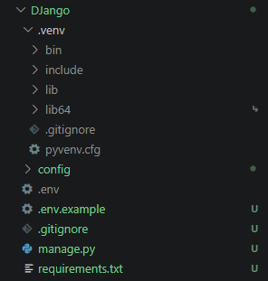  
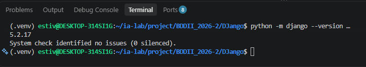  

---

## 🛠️ ISS-01 — Settings y Selección del Motor

### 1. Descripción y Objetivos
Refactorizar la configuración base convirtiendo `config/settings.py` en un paquete modular (`config/settings/`), habilitar la lectura de variables de entorno con `python-dotenv`, instalar los drivers multibasadedatos (`psycopg`, `mysqlclient`, `mssql-django`, `oracledb`) e implementar la selección dinámica del motor en `config/database.py` mediante la variable `DB_ENGINE`.

### 2. Comandos Ejecutados
```bash
# 1. Instalación de drivers de BD y lectura de .env
source .venv/bin/activate
python -m pip install "python-dotenv==1.2.3"
python -m pip install "psycopg[binary]==3.3.6"
python -m pip install "mysqlclient==2.3.0"
python -m pip install "mssql-django==2.0.0"
python -m pip install "oracledb==26.0.1"

# 2. Congelamiento de dependencias actualizadas
python -m pip freeze > requirements.txt

# 3. Conversión de settings.py a paquete
rm config/settings.py
mkdir -p config/settings

# 4. Creación de plantillas de entorno .env.example y .env
cat > .env.example <<'EOF'
DJANGO_SECRET_KEY=django-insecure-storelab-key-2026-secret
DJANGO_DEBUG=True
DJANGO_ALLOWED_HOSTS=localhost,127.0.0.1,testserver

DB_ENGINE=sqlite

POSTGRES_DB=
POSTGRES_USER=
POSTGRES_PASSWORD=
POSTGRES_HOST=127.0.0.1
POSTGRES_PORT=5432

MYSQL_DB=
MYSQL_USER=
MYSQL_PASSWORD=
MYSQL_HOST=127.0.0.1
MYSQL_PORT=3306

MSSQL_DB=
MSSQL_USER=
MSSQL_PASSWORD=
MSSQL_HOST=127.0.0.1
MSSQL_PORT=1433

ORACLE_DB=
ORACLE_USER=
ORACLE_PASSWORD=
ORACLE_HOST=127.0.0.1
ORACLE_PORT=1521
ORACLE_SERVICE_NAME=

CORS_ALLOW_ALL_ORIGINS=True
EOF

cp .env.example .env
```

### 3. Archivos Creados y Modificados
- **`config/database.py`**: Módulo encargado de construir la configuración de `DATABASES["default"]` dinámicamente según `DB_ENGINE` (`postgresql`, `mysql`, `mssql`, `oracle`, `sqlite`).
- **`config/settings/__init__.py`**: Paquete de configuración modular que carga `.env` e inicializa las constantes principales del sistema.
- **`config/project_python.py`**: Módulo para asegurar la reejecución del proceso dentro del intérprete de `.venv`.
- **`manage.py` / `config/wsgi.py` / `config/asgi.py`**: Actualizados para invocar `load_dotenv()` y el salto a `.venv` de forma segura.

### 4. Evidencias
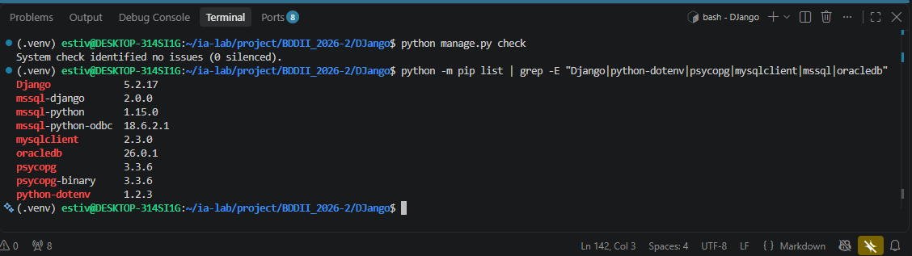  

---

## 🛠️ ISS-02 — Apps client, product y sale

### 1. Descripción y Objetivos
Crear y estructurar las tres aplicaciones principales del dominio de negocio (`client`, `product` y `sale`) dentro del paquete `apps/`. Registrar cada aplicación en `config/settings/__init__.py` ajustando la propiedad `name` (`apps.client`, `apps.product`, `apps.sale`) y manteniendo sus etiquetas cortas (`label`).

### 2. Comandos Ejecutados
```bash
# 1. Crear estructura de carpetas y paquete apps
mkdir -p apps/client apps/product apps/sale
touch apps/__init__.py

# 2. Generar aplicaciones con la CLI de Django
python manage.py startapp client apps/client
python manage.py startapp product apps/product
python manage.py startapp sale apps/sale

# 3. Verificación de registro correcto del sistema
python manage.py check
```

### 3. Archivos Creados y Modificados
- **`apps/client/apps.py`**: Configurado con `name = "apps.client"` y `label = "client"`.
- **`apps/product/apps.py`**: Configurado con `name = "apps.product"` y `label = "product"`.
- **`apps/sale/apps.py`**: Configurado con `name = "apps.sale"` y `label = "sale"`.
- **`config/settings/__init__.py`**: Se agregaron las tres configuraciones (`ClientConfig`, `ProductConfig`, `SaleConfig`) a `INSTALLED_APPS`.

### 4. Evidencias
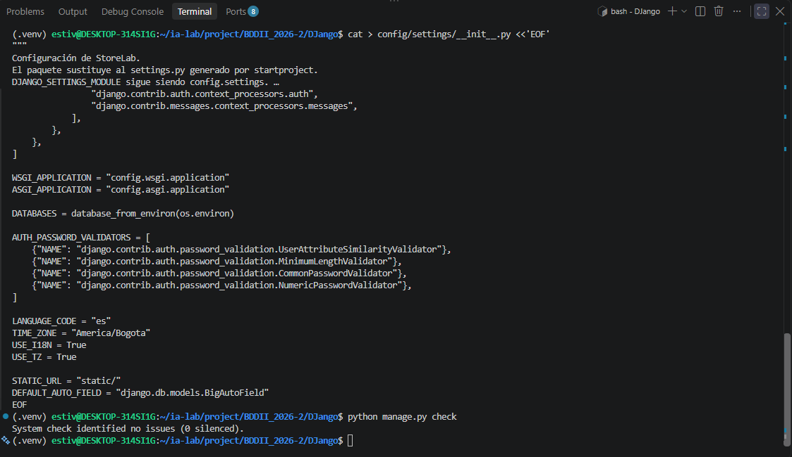  
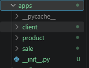  

---

## 🛠️ ISS-03 — Custom User antes de la primera migración

### 1. Descripción y Objetivos
Definir la entidad de usuario personalizada `User` sobre `django.contrib.auth.models.AbstractUser` y fijar la constante `AUTH_USER_MODEL = "security.User"` antes de ejecutar la primera migración del proyecto. Se incluye la enumeración de estados `RecordStatus` (`active`, `inactive`) en `apps/common/status.py` y se implementa `StoreUserManager` para controlar la activación por defecto según el rol.

### 2. Comandos Ejecutados
```bash
# 1. Crear módulo compartido de estado
mkdir -p apps/common
cat > apps/common/__init__.py <<'EOF'
EOF

cat > apps/common/status.py <<'EOF'
from django.db import models

class RecordStatus(models.TextChoices):
    ACTIVE = "active", "Active"
    INACTIVE = "inactive", "Inactive"
EOF

# 2. Crear app de seguridad y registrarla
mkdir -p apps/security
python manage.py startapp security apps/security

# 3. Generar la migración inicial del modelo personalizado de usuario
python manage.py makemigrations security

# 4. Aplicar las migraciones a la base de datos
python manage.py migrate

# 5. Ejecución de suite de pruebas unitarias de selección de motor
python manage.py test apps.security.tests.DatabaseSelectionTests
```

### 3. Archivos Creados y Modificados
- **`apps/common/status.py`**: Define la enumeración `RecordStatus` (`ACTIVE`, `INACTIVE`).
- **`apps/security/models.py`**: Implementa `StoreUserManager` y la clase `User` extendiendo `AbstractUser` con campos `status`, `email` único, restricciones del sistema y sincronización de `is_active`.
- **`apps/security/apps.py`**: Ajustado con `name = "apps.security"` y `label = "security"`.
- **`config/settings/__init__.py`**: Incluye `SecurityConfig` en `INSTALLED_APPS` y establece `AUTH_USER_MODEL = "security.User"`.
- **`apps/security/tests.py`**: Contiene la suite `DatabaseSelectionTests` para validar la lógica de selección de motores del sistema.

### 4. Evidencias
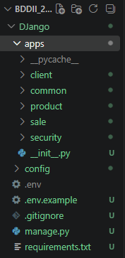
---
## 🛠️ ISS-04 — Modelo Client

### 1. Descripción y Objetivos
Implementar los modelos abstractos base `TimeStampedModel` y `StoreLabModel` en `apps/common/models.py` para abstraer campos de auditoría (`created_at`, `updated_at`), el estado por defecto (`status = INACTIVE`) y la restricción reutilizable de estados `RecordStatus`. Definir la entidad `Client` en `apps/client/models.py` extendiendo de `StoreLabModel`, asignando la tabla física `clients`, validación de longitud mínima del nombre (`MinLengthValidator`), unicidad y normalización del correo electrónico a minúsculas en el método `save()`.

### 2. Comandos Ejecutados
```bash
# 1. Definir los modelos abstractos comunes
cat > apps/common/models.py <<'EOF'
from django.db import models
from apps.common.status import RecordStatus

class TimeStampedModel(models.Model):
    created_at = models.DateTimeField(auto_now_add=True)
    updated_at = models.DateTimeField(auto_now=True)

    class Meta:
        abstract = True

class StoreLabModel(TimeStampedModel):
    status = models.CharField(
        max_length=8,
        choices=RecordStatus.choices,
        default=RecordStatus.INACTIVE,
    )

    class Meta:
        abstract = True

    @classmethod
    def status_constraint(cls, name):
        return models.CheckConstraint(
            condition=models.Q(status__in=RecordStatus.values),
            name=name,
        )
EOF

# 2. Crear el modelo Client en la app client
cat > apps/client/models.py <<'EOF'
from django.core.validators import MinLengthValidator
from django.db import models
from apps.common.models import StoreLabModel

class Client(StoreLabModel):
    name = models.CharField(max_length=150, validators=[MinLengthValidator(2)])
    address = models.CharField(max_length=255, null=True, blank=True)
    phone = models.CharField(max_length=30, null=True, blank=True)
    email = models.EmailField(max_length=150, null=True, blank=True, unique=True)

    class Meta:
        db_table = "clients"
        verbose_name = "cliente"
        verbose_name_plural = "clientes"
        ordering = ["name", "id"]
        constraints = [StoreLabModel.status_constraint("clients_status_valid")]

    def __str__(self):
        return self.name

    def save(self, *args, **kwargs):
        if self.email:
            self.email = self.email.strip().lower()
        super().save(*args, **kwargs)
EOF

# 3. Generar la migración inicial de client
python manage.py makemigrations client

# 4. Verificar la integridad del sistema
python manage.py check
```

### 3. Archivos Creados y Modificados
- **`apps/common/models.py`**: Modelos abstractos `TimeStampedModel` y `StoreLabModel` para la reutilización de timestamps de auditoría y restricción de estado `RecordStatus`.
- **`apps/client/models.py`**: Definición de la entidad `Client` heredada de `StoreLabModel`, mapeada a la tabla `clients` con validaciones de correo electrónico y longitud de nombre.

### 4. Evidencias
---
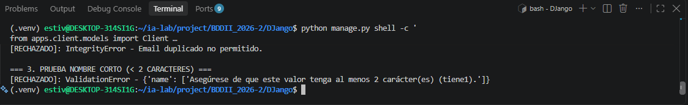
---
## 🛠️ ISS-05 — ProductType y Product

### 1. Descripción y Objetivos
Modelar la jerarquía del catálogo de productos garantizando la integridad referencial $1 \rightarrow N$ entre `ProductType` y `Product`. Se configuran las tablas físicas `product_types` y `products`, heredando de `StoreLabModel` para reutilizar estado (`status` por defecto `inactive`) y timestamps. La clave foránea `product_type_id` utiliza la cláusula `on_delete=models.RESTRICT` para impedir el borrado de categorías con productos asociados, y se imponen restricciones de unicidad en nombres y precios no negativos (`price >= 0`).

### 2. Comandos Ejecutados
```bash
# 1. Definir los modelos ProductType y Product
cat > apps/product/models.py <<'EOF'
from decimal import Decimal
from django.core.validators import MinLengthValidator, MinValueValidator
from django.db import models
from apps.common.models import StoreLabModel

class ProductType(StoreLabModel):
    name = models.CharField(max_length=100, unique=True, validators=[MinLengthValidator(2)])
    description = models.CharField(max_length=255, null=True, blank=True)

    class Meta:
        db_table = "product_types"
        verbose_name = "tipo de producto"
        verbose_name_plural = "tipos de producto"
        ordering = ["name", "id"]
        constraints = [StoreLabModel.status_constraint("product_types_status_valid")]

    def __str__(self):
        return self.name

class Product(StoreLabModel):
    product_type = models.ForeignKey(
        ProductType,
        on_delete=models.RESTRICT,
        related_name="products",
        db_column="product_type_id",
    )
    name = models.CharField(max_length=120, unique=True, validators=[MinLengthValidator(2)])
    description = models.CharField(max_length=255, null=True, blank=True)
    price = models.DecimalField(
        max_digits=12,
        decimal_places=2,
        validators=[MinValueValidator(Decimal("0"))],
    )
    stock = models.PositiveIntegerField(default=0)

    class Meta:
        db_table = "products"
        verbose_name = "producto"
        verbose_name_plural = "productos"
        ordering = ["name", "id"]
        constraints = [
            StoreLabModel.status_constraint("products_status_valid"),
            models.CheckConstraint(
                condition=models.Q(price__gte=0),
                name="product_price_non_neg",
            ),
        ]

    def __str__(self):
        return self.name
EOF

# 2. Generar y aplicar la migración inicial de product
python manage.py makemigrations product
python manage.py migrate

# 3. Verificación de integridad del sistema
python manage.py check
```

### 3. Archivos Creados y Modificados
- **`apps/product/models.py`**: Contiene la definición de las entidades `ProductType` y `Product` con sus restricciones de estado, precios no negativos e integridad referencial restrictiva.

### 4. Evidencias
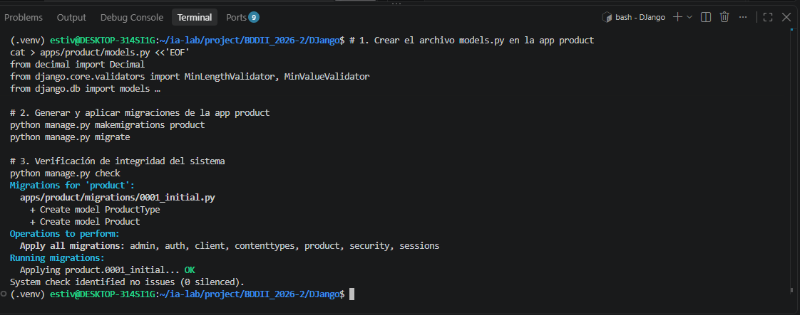
Test
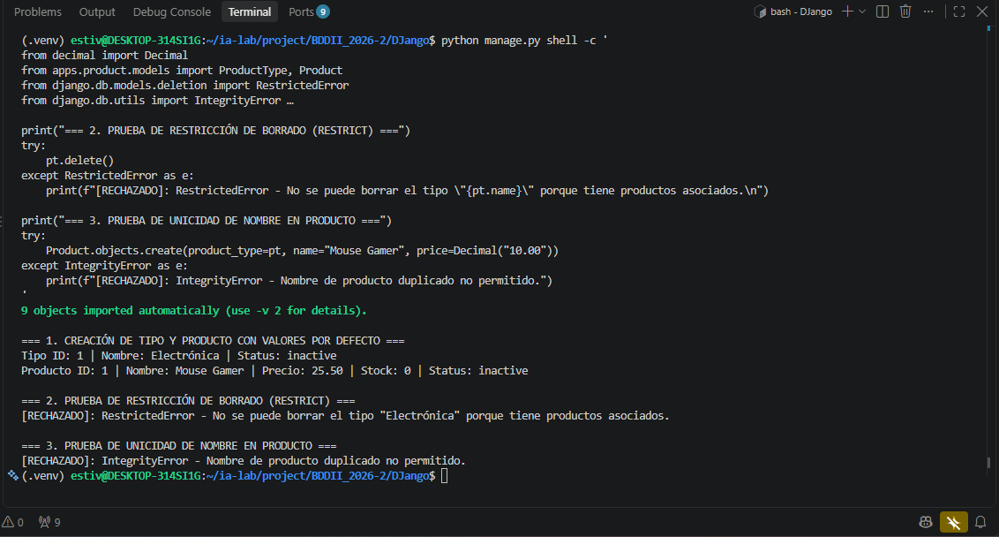
---
## 🛠️ ISS-06 — Sale y ProductSale

### 1. Descripción y Objetivos
Modelar el encabezado de transacciones (`Sale`) y su detalle explícito (`ProductSale`), descartando relaciones `ManyToManyField` directas para preservar la integridad del historial comercial. Se incluye el campo de almacenamiento de precio unitario `unit_price` en `ProductSale` para congelar el valor de compra al momento de la transacción. Se implementa la automatización del cálculo de `line_total` en el método `save()` y el método `void()` en `Sale` para gestionar la anulación atómica de ventas y la devolución de inventario a la tabla `products`.

### 2. Comandos Ejecutados
```bash
# 1. Crear el manager base de la app sale
cat > apps/sale/managers.py <<'EOF'
from django.db import models

class SaleQuerySet(models.QuerySet):
    pass

class SaleManager(models.Manager.from_queryset(SaleQuerySet)):
    pass
EOF

# 2. Definir los modelos Sale y ProductSale
cat > apps/sale/models.py <<'EOF'
from decimal import Decimal
from django.core.validators import MinValueValidator
from django.db import models, transaction
from apps.client.models import Client
from apps.common.models import StoreLabModel
from apps.common.status import RecordStatus
from apps.product.models import Product
from apps.sale.managers import SaleManager

class Sale(StoreLabModel):
    client = models.ForeignKey(
        Client,
        on_delete=models.RESTRICT,
        related_name="sales",
        db_column="client_id",
    )
    sale_date = models.DateTimeField()
    subtotal = models.DecimalField(max_digits=12, decimal_places=2, default=Decimal("0.00"))
    tax = models.DecimalField(max_digits=12, decimal_places=2, default=Decimal("0.00"))
    discounts = models.DecimalField(max_digits=12, decimal_places=2, default=Decimal("0.00"))
    total = models.DecimalField(max_digits=12, decimal_places=2, default=Decimal("0.00"))

    objects = SaleManager()

    class Meta:
        db_table = "sales"
        verbose_name = "venta"
        verbose_name_plural = "ventas"
        ordering = ["-sale_date", "-id"]
        constraints = [
            StoreLabModel.status_constraint("sales_status_valid"),
            models.CheckConstraint(
                condition=models.Q(subtotal__gte=0)
                & models.Q(tax__gte=0)
                & models.Q(discounts__gte=0)
                & models.Q(total__gte=0),
                name="sales_amounts_non_neg",
            ),
        ]

    def __str__(self):
        return f"Venta {self.pk}"

    def void(self):
        with transaction.atomic():
            sale = Sale.objects.select_for_update().get(pk=self.pk)
            if sale.status == RecordStatus.INACTIVE:
                return sale
            lines = sale.lines.select_related("product").select_for_update().order_by("product_id")
            for line in lines:
                if line.status != RecordStatus.ACTIVE:
                    continue
                product = Product.objects.select_for_update().get(pk=line.product_id)
                product.stock += line.quantity
                product.save(update_fields=["stock", "updated_at"])
                line.status = RecordStatus.INACTIVE
                line.save(update_fields=["status", "updated_at"])
            sale.status = RecordStatus.INACTIVE
            sale.save(update_fields=["status", "updated_at"])
            return sale

class ProductSale(StoreLabModel):
    sale = models.ForeignKey(
        Sale,
        on_delete=models.RESTRICT,
        related_name="lines",
        db_column="sale_id",
    )
    product = models.ForeignKey(
        Product,
        on_delete=models.RESTRICT,
        related_name="sale_lines",
        db_column="product_id",
    )
    quantity = models.PositiveIntegerField(validators=[MinValueValidator(1)])
    unit_price = models.DecimalField(max_digits=12, decimal_places=2)
    line_total = models.DecimalField(max_digits=12, decimal_places=2)

    class Meta:
        db_table = "product_sales"
        verbose_name = "detalle de venta"
        verbose_name_plural = "detalles de venta"
        ordering = ["id"]
        constraints = [
            StoreLabModel.status_constraint("product_sales_status_valid"),
            models.CheckConstraint(
                condition=models.Q(quantity__gte=1)
                & models.Q(unit_price__gte=0)
                & models.Q(line_total__gte=0),
                name="psale_amounts_valid",
            ),
        ]

    def __str__(self):
        return f"{self.product} x {self.quantity}"

    def save(self, *args, **kwargs):
        self.line_total = (self.unit_price * self.quantity).quantize(Decimal("0.01"))
        super().save(*args, **kwargs)
EOF

# 3. Generar y aplicar migraciones
python manage.py makemigrations sale
python manage.py migrate

# 4. Chequeo de consistencia del proyecto
python manage.py check
```

### 3. Archivos Creados y Modificados
- **`apps/sale/managers.py`**: Inicialización del `SaleQuerySet` y `SaleManager` para albergar operaciones personalizadas de ventas.
- **`apps/sale/models.py`**: Mapeo de las tablas `sales` y `product_sales` con restricciones de montos no negativos, cálculo dinámico de `line_total` y método `void()` para anulación atómica.
---
### 4. Evidencias
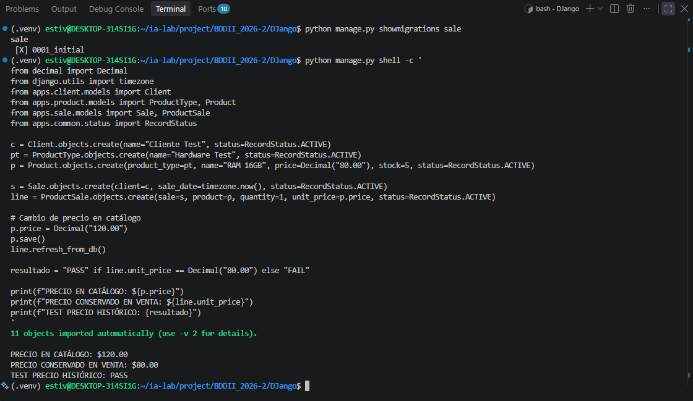
---
## 🛠️ ISS-07 — Serializers y JSON camelCase

### 1. Descripción y Objetivos
Incorporar **Django REST Framework (DRF)**, **djangorestframework-camel-case** y **django-cors-headers** en la arquitectura del proyecto para construir la capa de serialización. Se crean los componentes `ClientSerializer`, `ProductTypeSerializer`, `ProductSerializer`, `ProductSaleSerializer` y `SaleSerializer`. La configuración de DRF traduce automáticamente los atributos Python (`snake_case`) a identificadores JSON (`camelCase`) en la salida HTTP sin modificar las definiciones del ORM en el backend, e implementa reglas sanitizadoras como la conversión de cadenas vacías de email a `None` y su normalización a minúsculas.

### 2. Comandos Ejecutados
```bash
# 1. Instalación de paquetes de API REST y CORS
source .venv/bin/activate
python -m pip install "djangorestframework==3.17.2" "djangorestframework-camel-case==1.4.2" "django-cors-headers==4.9.0"
python -m pip freeze > requirements.txt

# 2. Crear ClientSerializer en apps/client/serializers.py
cat > apps/client/serializers.py <<'EOF'
from rest_framework import serializers
from apps.client.models import Client

class ClientSerializer(serializers.ModelSerializer):
    class Meta:
        model = Client
        fields = [
            "id",
            "name",
            "address",
            "phone",
            "email",
            "status",
            "created_at",
            "updated_at",
        ]
        read_only_fields = ["id", "created_at", "updated_at"]
        extra_kwargs = {
            "name": {"min_length": 2, "max_length": 150},
            "email": {"required": False, "allow_null": True, "allow_blank": True},
            "address": {"required": False, "allow_null": True, "allow_blank": True},
            "phone": {"required": False, "allow_null": True, "allow_blank": True},
        }

    def validate_email(self, value):
        if value is None or str(value).strip() == "":
            return None
        return value.strip().lower()

    def validate(self, attrs):
        for field in ("address", "phone"):
            if attrs.get(field) == "":
                attrs[field] = None
        return attrs
EOF

# 3. Crear ProductTypeSerializer y ProductSerializer en apps/product/serializers.py
cat > apps/product/serializers.py <<'EOF'
from rest_framework import serializers
from apps.product.models import Product, ProductType

class ProductTypeSerializer(serializers.ModelSerializer):
    class Meta:
        model = ProductType
        fields = ["id", "name", "description", "status", "created_at", "updated_at"]
        read_only_fields = ["id", "created_at", "updated_at"]
        extra_kwargs = {
            "name": {"min_length": 2, "max_length": 100},
            "description": {"required": False, "allow_null": True, "allow_blank": True},
        }

    def validate_description(self, value):
        if value is None or str(value).strip() == "":
            return None
        return value

class ProductSerializer(serializers.ModelSerializer):
    product_type_id = serializers.PrimaryKeyRelatedField(
        source="product_type",
        queryset=ProductType.objects.all(),
    )
    product_type_name = serializers.CharField(source="product_type.name", read_only=True)

    class Meta:
        model = Product
        fields = [
            "id",
            "product_type_id",
            "product_type_name",
            "name",
            "description",
            "price",
            "stock",
            "status",
            "created_at",
            "updated_at",
        ]
        read_only_fields = ["id", "product_type_name", "created_at", "updated_at"]
        extra_kwargs = {
            "name": {"min_length": 2, "max_length": 120},
            "description": {"required": False, "allow_null": True, "allow_blank": True},
        }

    def validate_description(self, value):
        if value is None or str(value).strip() == "":
            return None
        return value
EOF

# 4. Crear ProductSaleSerializer y SaleSerializer en apps/sale/serializers.py
cat > apps/sale/serializers.py <<'EOF'
from rest_framework import serializers
from apps.sale.models import ProductSale, Sale

class ProductSaleSerializer(serializers.ModelSerializer):
    product_name = serializers.CharField(source="product.name", read_only=True)

    class Meta:
        model = ProductSale
        fields = [
            "id",
            "product",
            "product_name",
            "quantity",
            "unit_price",
            "line_total",
            "status",
            "created_at",
            "updated_at",
        ]
        read_only_fields = fields

class SaleSerializer(serializers.ModelSerializer):
    client_name = serializers.CharField(source="client.name", read_only=True)
    lines = ProductSaleSerializer(many=True, read_only=True)

    class Meta:
        model = Sale
        fields = [
            "id",
            "client",
            "client_name",
            "sale_date",
            "subtotal",
            "tax",
            "discounts",
            "total",
            "status",
            "lines",
            "created_at",
            "updated_at",
        ]
        read_only_fields = fields
EOF

# 5. Chequeo de consistencia general del sistema
python manage.py check
```

### 3. Archivos Creados y Modificados
- **`config/settings/__init__.py`**: Registro de `rest_framework` y `corsheaders` en `INSTALLED_APPS`, middleware `CorsMiddleware`, y declaración de renderizadores y parsers `CamelCase` en la constante `REST_FRAMEWORK`.
- **`apps/client/serializers.py`**: Definición de `ClientSerializer` con sanitización de `email`, `address` y `phone` a `None`.
- **`apps/product/serializers.py`**: Definición de `ProductTypeSerializer` y `ProductSerializer` exponiendo `product_type_id` escribible y `product_type_name` de solo lectura.
- **`apps/sale/serializers.py`**: Definición de `ProductSaleSerializer` y `SaleSerializer` para la exposición de encabezados y líneas de venta.

### 4. Evidencias
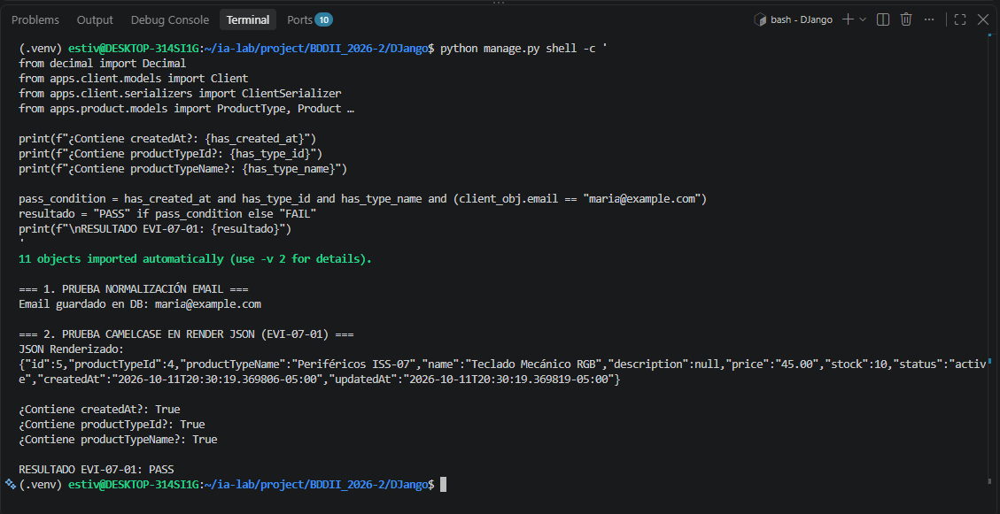
---
## 🛠️ ISS-08 — Client con ModelViewSet

### 1. Descripción y Objetivos
Publicar las operaciones CRUD para el recurso `Client` a través del endpoint `/api/clients/` implementando `ModelViewSet` y un enrutador `SimpleRouter(use_regex_path=False)`. En esta Fase I el recurso se expone con permisos de acceso abierto (`AllowAny`). Se redefine el método `perform_destroy` para sustituir el borrado físico de la base de datos por una baja lógica (`status = RecordStatus.INACTIVE`), preservando la integridad referencial y el historial de datos.

### 2. Comandos Ejecutados
```bash
# 1. Definir ClientViewSet con baja lógica personalizada
cat > apps/client/views.py <<'EOF'
from rest_framework import viewsets
from rest_framework.permissions import AllowAny
from apps.client.models import Client
from apps.client.serializers import ClientSerializer
from apps.common.status import RecordStatus

class ClientViewSet(viewsets.ModelViewSet):
    queryset = Client.objects.all()
    serializer_class = ClientSerializer
    permission_classes = [AllowAny]
    lookup_value_converter = "int"

    def get_queryset(self):
        queryset = super().get_queryset()
        status_value = self.request.query_params.get("status")
        if status_value:
            queryset = queryset.filter(status=status_value)
        return queryset

    def perform_destroy(self, instance):
        instance.status = RecordStatus.INACTIVE
        instance.save(update_fields=["status", "updated_at"])
EOF

# 2. Implementar suite de pruebas API para Client
cat > apps/client/tests.py <<'EOF'
import json
from rest_framework import status
from rest_framework.test import APITestCase
from apps.client.models import Client
from apps.common.status import RecordStatus

class ClientApiTests(APITestCase):
    def test_create_defaults_and_persists(self):
        response = self.client.post(
            "/api/clients/",
            {"name": "María García", "email": "Maria@Example.com", "phone": "3001234567"},
            format="json",
        )
        self.assertEqual(response.status_code, status.HTTP_201_CREATED)
        self.assertEqual(response.data["status"], RecordStatus.INACTIVE)
        self.assertEqual(response.data["email"], "maria@example.com")
        wire = json.loads(response.content)
        self.assertIn("createdAt", wire)
        self.assertNotIn("created_at", wire)
        stored = Client.objects.get(pk=response.data["id"])
        self.assertEqual(stored.name, "María García")

    def test_invalid_name_and_duplicate_email(self):
        invalid = self.client.post("/api/clients/", {"name": "A"}, format="json")
        self.assertEqual(invalid.status_code, status.HTTP_400_BAD_REQUEST)
        self.client.post(
            "/api/clients/",
            {"name": "Ana Ruiz", "email": "ana@example.com"},
            format="json",
        )
        duplicate = self.client.post(
            "/api/clients/",
            {"name": "Otra Ana", "email": "ana@example.com"},
            format="json",
        )
        self.assertEqual(duplicate.status_code, status.HTTP_400_BAD_REQUEST)

    def test_soft_delete_keeps_the_row(self):
        created = self.client.post("/api/clients/", {"name": "Pedro León"}, format="json")
        deleted = self.client.delete(f"/api/clients/{created.data['id']}/")
        self.assertEqual(deleted.status_code, status.HTTP_204_NO_CONTENT)
        stored = Client.objects.get(pk=created.data["id"])
        self.assertEqual(stored.status, RecordStatus.INACTIVE)
        self.assertEqual(Client.objects.count(), 1)

    def test_list_retrieve_and_update(self):
        created = self.client.post(
            "/api/clients/",
            {"name": "Luisa Mora", "phone": "111"},
            format="json",
        )
        pk = created.data["id"]
        listed = self.client.get("/api/clients/")
        self.assertEqual(listed.status_code, status.HTTP_200_OK)
        detail = self.client.get(f"/api/clients/{pk}/")
        self.assertEqual(detail.status_code, status.HTTP_200_OK)
        self.assertEqual(detail.data["name"], "Luisa Mora")
        updated = self.client.patch(
            f"/api/clients/{pk}/",
            {"phone": "222", "status": "active"},
            format="json",
        )
        self.assertEqual(updated.status_code, status.HTTP_200_OK)
        self.assertEqual(updated.data["status"], "active")
EOF

# 3. Configurar enrutador de la app client
cat > apps/client/urls.py <<'EOF'
from rest_framework.routers import SimpleRouter
from apps.client.views import ClientViewSet

router = SimpleRouter(use_regex_path=False)
router.register("clients", ClientViewSet, basename="client")
urlpatterns = router.urls
EOF

# 4. Enlazar la ruta /api/ en config/urls.py
python -c '
from pathlib import Path

path = Path("config/urls.py")
content = path.read_text()

if "from django.urls import include, path" not in content:
    content = content.replace("from django.urls import path", "from django.urls import include, path")

if "apps.client.urls" not in content:
    content = content.replace(
        "path(\"admin/\", admin.site.urls),",
        "path(\"admin/\", admin.site.urls),\n    path(\"api/\", include(\"apps.client.urls\")),"
    )

path.write_text(content)
print("config/urls.py actualizado correctamente.")
'

# 5. Verificación de integridad
python manage.py check
```

### 3. Archivos Creados y Modificados
- **`apps/client/views.py`**: Implementación de `ClientViewSet` heredando de `ModelViewSet` con baja lógica en `perform_destroy` y filtrado por `status`.
- **`apps/client/urls.py`**: Enrutamiento de `ClientViewSet` bajo la ruta `clients/` usando `SimpleRouter`.
- **`config/urls.py`**: Inclusión del prefijo `/api/` enlazado a las rutas de `apps.client.urls`.
- **`apps/client/tests.py`**: Pruebas automáticas `ClientApiTests` para validar creación, errores 400 por nombre corto/email duplicado, baja lógica y actualización.

### 4. Evidencias
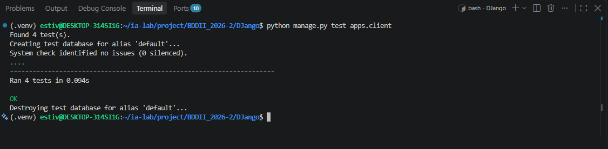
---
## 🛠️ ISS-09 — Catálogo con ModelViewSet

### 1. Descripción y Objetivos
Publicar las APIs del catálogo para las entidades `ProductType` y `Product` bajo los endpoints `/api/product-types/` y `/api/products/`. Se abstrae la lógica genérica del CRUD extendiendo de un `CatalogViewSet` base en modo de acceso abierto (`AllowAny`), implementando filtrado por el parámetro `?status=` y baja lógica en el método `perform_destroy`. Se optimizan las consultas de lectura en productos mediante `select_related("product_type")` para evitar consultas N+1.

### 2. Comandos Ejecutados
```bash
# 1. Definir Vistas en apps/product/views.py
cat > apps/product/views.py <<'EOF'
from rest_framework import viewsets
from rest_framework.permissions import AllowAny
from apps.common.status import RecordStatus
from apps.product.models import Product, ProductType
from apps.product.serializers import ProductSerializer, ProductTypeSerializer

class CatalogViewSet(viewsets.ModelViewSet):
    permission_classes = [AllowAny]
    lookup_value_converter = "int"

    def get_queryset(self):
        queryset = super().get_queryset()
        status_value = self.request.query_params.get("status")
        if status_value:
            queryset = queryset.filter(status=status_value)
        return queryset

    def perform_destroy(self, instance):
        instance.status = RecordStatus.INACTIVE
        instance.save(update_fields=["status", "updated_at"])

class ProductTypeViewSet(CatalogViewSet):
    queryset = ProductType.objects.all()
    serializer_class = ProductTypeSerializer

class ProductViewSet(CatalogViewSet):
    queryset = Product.objects.select_related("product_type")
    serializer_class = ProductSerializer
EOF

# 2. Configurar enrutador de la app product
cat > apps/product/urls.py <<'EOF'
from rest_framework.routers import SimpleRouter
from apps.product.views import ProductTypeViewSet, ProductViewSet

router = SimpleRouter(use_regex_path=False)
router.register("product-types", ProductTypeViewSet, basename="product-type")
router.register("products", ProductViewSet, basename="product")

urlpatterns = router.urls
EOF

# 3. Incluir las rutas de producto en config/urls.py
cat > config/urls.py <<'EOF'
from django.contrib import admin
from django.urls import include, path

urlpatterns = [
    path("admin/", admin.site.urls),
    path("api/", include("apps.client.urls")),
    path("api/", include("apps.product.urls")),
]
EOF

# 4. Implementar las pruebas del API de catálogo
cat > apps/product/tests.py <<'EOF'
from decimal import Decimal
from django.db.models.deletion import RestrictedError
from rest_framework.test import APITestCase
from apps.common.status import RecordStatus
from apps.product.models import Product, ProductType

class ProductApiTests(APITestCase):
    def setUp(self):
        self.product_type = ProductType.objects.create(name="Bebida", status=RecordStatus.ACTIVE)

    def test_product_type_crud(self):
        created = self.client.post(
            "/api/product-types/",
            {"name": "Lácteo", "description": "Fríos"},
            format="json",
        )
        self.assertEqual(created.status_code, 201)
        self.assertEqual(created.data["status"], RecordStatus.INACTIVE)
        pk = created.data["id"]
        self.assertEqual(self.client.get("/api/product-types/").status_code, 200)
        detail = self.client.get(f"/api/product-types/{pk}/")
        self.assertEqual(detail.data["name"], "Lácteo")
        updated = self.client.patch(
            f"/api/product-types/{pk}/",
            {"status": "active"},
            format="json",
        )
        self.assertEqual(updated.status_code, 200)
        deleted = self.client.delete(f"/api/product-types/{pk}/")
        self.assertEqual(deleted.status_code, 204)
        self.assertEqual(ProductType.objects.get(pk=pk).status, RecordStatus.INACTIVE)

    def test_product_retrieve_update_and_soft_delete(self):
        created = self.client.post(
            "/api/products/",
            {
                "productTypeId": self.product_type.id,
                "name": "Leche",
                "price": "3.20",
                "stock": 2,
                "status": "active",
            },
            format="json",
        )
        pk = created.data["id"]
        detail = self.client.get(f"/api/products/{pk}/")
        self.assertEqual(detail.status_code, 200)
        updated = self.client.patch(f"/api/products/{pk}/", {"stock": 9}, format="json")
        self.assertEqual(updated.status_code, 200)
        self.assertEqual(updated.data["stock"], 9)
        deleted = self.client.delete(f"/api/products/{pk}/")
        self.assertEqual(deleted.status_code, 204)
        self.assertEqual(Product.objects.get(pk=pk).status, RecordStatus.INACTIVE)

    def test_default_status_and_type_restriction(self):
        created = self.client.post(
            "/api/products/",
            {"productTypeId": self.product_type.id, "name": "Té", "price": "1.00"},
            format="json",
        )
        self.assertEqual(created.status_code, 201)
        self.assertEqual(created.data["status"], "inactive")
        self.assertEqual(created.data["stock"], 0)
        with self.assertRaises(RestrictedError):
            self.product_type.delete()

    def test_duplicate_product_name(self):
        payload = {"productTypeId": self.product_type.id, "name": "Café", "price": "3.00"}
        self.assertEqual(self.client.post("/api/products/", payload, format="json").status_code, 201)
        self.assertEqual(self.client.post("/api/products/", payload, format="json").status_code, 400)
        self.assertEqual(Product.objects.get(name="Café").price, Decimal("3.00"))
EOF

# 5. Verificación de consistencia del proyecto
python manage.py check
```

### 3. Archivos Creados y Modificados
- **`apps/product/views.py`**: Implementación de `CatalogViewSet`, `ProductTypeViewSet` y `ProductViewSet` con borrado lógico y filtros de consulta.
- **`apps/product/urls.py`**: Registro de las rutas `product-types` y `products` utilizando `SimpleRouter`.
- **`config/urls.py`**: Inclusión de las rutas de la app `product` bajo la base `/api/`.
- **`apps/product/tests.py`**: Pruebas automáticas `ProductApiTests` para validar operaciones CRUD, valores por defecto, restricciones `RESTRICT` de borrado y control de duplicados.

### 4. Evidencias
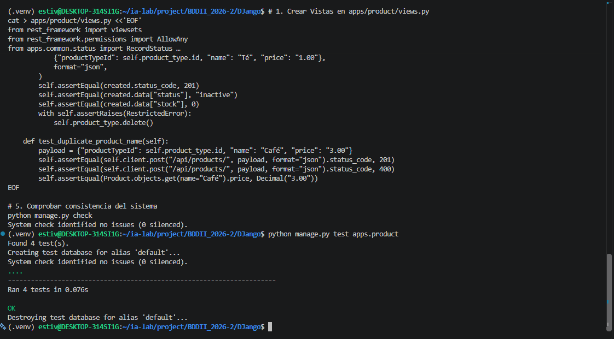
---
## 🛠️ ISS-10 — Disponibles con ListAPIView

### 1. Descripción y Objetivos
Implementar la vista especializada de lectura `AvailableProductListAPIView` heredando de `ListAPIView` para publicar la colección filtrada de productos disponibles en el endpoint `/api/products/available/`. La consulta restringe la salida a productos que tengan estado activo (`status='active'`), existencia física positiva (`stock > 0`) y cuya categoría asociada esté igualmente activa. La ruta explícita `products/available/` se ubica por delante del `router.urls` en `apps/product/urls.py` para garantizar el orden de resolución de URLs en Django REST Framework.

### 2. Comandos Ejecutados
```bash
# 1. Definir AvailableProductListAPIView en apps/product/views.py
cat > apps/product/views.py <<'EOF'
from rest_framework import viewsets
from rest_framework.generics import ListAPIView
from rest_framework.permissions import AllowAny
from apps.common.status import RecordStatus
from apps.product.models import Product, ProductType
from apps.product.serializers import ProductSerializer, ProductTypeSerializer

class CatalogViewSet(viewsets.ModelViewSet):
    permission_classes = [AllowAny]
    lookup_value_converter = "int"

    def get_queryset(self):
        queryset = super().get_queryset()
        status_value = self.request.query_params.get("status")
        if status_value:
            queryset = queryset.filter(status=status_value)
        return queryset

    def perform_destroy(self, instance):
        instance.status = RecordStatus.INACTIVE
        instance.save(update_fields=["status", "updated_at"])

class ProductTypeViewSet(CatalogViewSet):
    queryset = ProductType.objects.all()
    serializer_class = ProductTypeSerializer

class ProductViewSet(CatalogViewSet):
    queryset = Product.objects.select_related("product_type")
    serializer_class = ProductSerializer

class AvailableProductListAPIView(ListAPIView):
    permission_classes = [AllowAny]
    serializer_class = ProductSerializer

    def get_queryset(self):
        return Product.objects.select_related("product_type").filter(
            status=RecordStatus.ACTIVE,
            stock__gt=0,
            product_type__status=RecordStatus.ACTIVE,
        )
EOF

# 2. Configurar anteposición de la URL en apps/product/urls.py
cat > apps/product/urls.py <<'EOF'
from django.urls import path
from rest_framework.routers import SimpleRouter
from apps.product.views import AvailableProductListAPIView, ProductTypeViewSet, ProductViewSet

router = SimpleRouter(use_regex_path=False)
router.register("product-types", ProductTypeViewSet, basename="product-type")
router.register("products", ProductViewSet, basename="product")

urlpatterns = [
    path(
        "products/available/",
        AvailableProductListAPIView.as_view(),
        name="product-available",
    ),
]
urlpatterns += router.urls
EOF

# 3. Incluir prueba de filtro en apps/product/tests.py
cat > apps/product/tests.py <<'EOF'
from decimal import Decimal
from django.db.models.deletion import RestrictedError
from rest_framework.test import APITestCase
from apps.common.status import RecordStatus
from apps.product.models import Product, ProductType

class ProductApiTests(APITestCase):
    def setUp(self):
        self.product_type = ProductType.objects.create(name="Bebida", status=RecordStatus.ACTIVE)

    def test_product_type_crud(self):
        created = self.client.post(
            "/api/product-types/",
            {"name": "Lácteo", "description": "Fríos"},
            format="json",
        )
        self.assertEqual(created.status_code, 201)
        self.assertEqual(created.data["status"], RecordStatus.INACTIVE)
        pk = created.data["id"]
        self.assertEqual(self.client.get("/api/product-types/").status_code, 200)
        detail = self.client.get(f"/api/product-types/{pk}/")
        self.assertEqual(detail.data["name"], "Lácteo")
        updated = self.client.patch(
            f"/api/product-types/{pk}/",
            {"status": "active"},
            format="json",
        )
        self.assertEqual(updated.status_code, 200)
        deleted = self.client.delete(f"/api/product-types/{pk}/")
        self.assertEqual(deleted.status_code, 204)
        self.assertEqual(ProductType.objects.get(pk=pk).status, RecordStatus.INACTIVE)

    def test_product_retrieve_update_and_soft_delete(self):
        created = self.client.post(
            "/api/products/",
            {
                "productTypeId": self.product_type.id,
                "name": "Leche",
                "price": "3.20",
                "stock": 2,
                "status": "active",
            },
            format="json",
        )
        pk = created.data["id"]
        detail = self.client.get(f"/api/products/{pk}/")
        self.assertEqual(detail.status_code, 200)
        updated = self.client.patch(f"/api/products/{pk}/", {"stock": 9}, format="json")
        self.assertEqual(updated.status_code, 200)
        self.assertEqual(updated.data["stock"], 9)
        deleted = self.client.delete(f"/api/products/{pk}/")
        self.assertEqual(deleted.status_code, 204)
        self.assertEqual(Product.objects.get(pk=pk).status, RecordStatus.INACTIVE)

    def test_default_status_and_type_restriction(self):
        created = self.client.post(
            "/api/products/",
            {"productTypeId": self.product_type.id, "name": "Té", "price": "1.00"},
            format="json",
        )
        self.assertEqual(created.status_code, 201)
        self.assertEqual(created.data["status"], "inactive")
        self.assertEqual(created.data["stock"], 0)
        with self.assertRaises(RestrictedError):
            self.product_type.delete()

    def test_duplicate_product_name(self):
        payload = {"productTypeId": self.product_type.id, "name": "Café", "price": "3.00"}
        self.assertEqual(self.client.post("/api/products/", payload, format="json").status_code, 201)
        self.assertEqual(self.client.post("/api/products/", payload, format="json").status_code, 400)
        self.assertEqual(Product.objects.get(name="Café").price, Decimal("3.00"))

    def test_product_crud_and_available_filter(self):
        created = self.client.post(
            "/api/products/",
            {
                "productTypeId": self.product_type.id,
                "name": "Agua",
                "price": "2.50",
                "stock": 4,
                "status": "active",
            },
            format="json",
        )
        self.assertEqual(created.status_code, 201)
        available = self.client.get("/api/products/available/")
        self.assertEqual(available.status_code, 200)
        self.assertEqual(len(available.data), 1)
        Product.objects.filter(pk=created.data["id"]).update(stock=0)
        empty = self.client.get("/api/products/available/")
        self.assertEqual(empty.data, [])
EOF

# 4. Chequeo de consistencia general
python manage.py check
```

### 3. Archivos Creados y Modificados
- **`apps/product/views.py`**: Adición de la vista `AvailableProductListAPIView` heredando de `ListAPIView` con filtrado por stock positivo y estados activos de producto y tipo.
- **`apps/product/urls.py`**: Declaración de la ruta explícita `products/available/` antes de concadenar las rutas automáticas del `SimpleRouter`.
- **`apps/product/tests.py`**: Adición del método de prueba `test_product_crud_and_available_filter` en `ProductApiTests`.

### 4. Evidencias
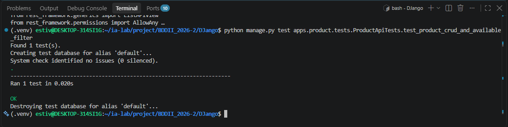
---
## 🛠️ ISS-11 — Registro de venta con APIView

### 1. Descripción y Objetivos
Implementar la transacción atómica de registro de ventas expuesta mediante el método `POST` en `/api/sales/`. Se programa el método `SaleQuerySet.register` dentro de un bloque `transaction.atomic()`, realizando el bloqueo pesimista mediante `select_for_update()` de la fila del cliente y los productos involucrados. El proceso efectúa la validación de estado activo, congruencia de existencias, congelamiento del precio unitario en `ProductSale`, cálculo automático de subtotal y total, deducción de inventario en `Product` y reversión completa (`rollback`) ante cualquier excepción o fallo transaccional.

### 2. Comandos Ejecutados
```bash
# 1. Definir SaleQuerySet.register en apps/sale/managers.py
cat > apps/sale/managers.py <<'EOF'
from decimal import Decimal
from django.core.exceptions import ValidationError
from django.db import models, transaction
from apps.common.status import RecordStatus
from apps.product.models import Product

class SaleQuerySet(models.QuerySet):
    def register(self, *, client, sale_date, items, discounts):
        if not items:
            raise ValidationError({"items": ["La venta requiere al menos un producto."]})
        discounts = Decimal(discounts).quantize(Decimal("0.01"))
        if discounts < 0:
            raise ValidationError({"discounts": ["El descuento no puede ser negativo."]})
        quantities = {}
        for item in items:
            quantity = int(item["quantity"])
            if quantity < 1:
                raise ValidationError({"items": ["La cantidad debe ser al menos 1."]})
            product_id = item["product_id"]
            quantities[product_id] = quantities.get(product_id, 0) + quantity
        with transaction.atomic():
            locked_client = client.__class__.objects.select_for_update().get(pk=client.pk)
            if locked_client.status != RecordStatus.ACTIVE:
                raise ValidationError({"client_id": ["El cliente debe estar active."]})
            locked_products = {
                product.id: product
                for product in Product.objects.select_for_update()
                .select_related("product_type")
                .filter(pk__in=quantities)
                .order_by("id")
            }
            if len(locked_products) != len(quantities):
                raise ValidationError({"items": ["Hay productos que no existen."]})
            for product_id, quantity in quantities.items():
                product = locked_products[product_id]
                if product.status != RecordStatus.ACTIVE:
                    raise ValidationError(
                        {"items": [f"El producto {product.name} no está active."]}
                    )
                if product.product_type.status != RecordStatus.ACTIVE:
                    raise ValidationError(
                        {"items": [f"El tipo de {product.name} no está active."]}
                    )
                if product.stock < quantity:
                    raise ValidationError(
                        {"items": [f"Stock insuficiente para {product.name}."]}
                    )
            sale = self.model(
                client=locked_client,
                sale_date=sale_date,
                subtotal=Decimal("0.00"),
                tax=Decimal("0.00"),
                discounts=discounts,
                total=Decimal("0.00"),
                status=RecordStatus.INACTIVE,
            )
            sale.save()
            subtotal = Decimal("0.00")
            for item in items:
                product = locked_products[item["product_id"]]
                unit_price = product.price
                quantity = int(item["quantity"])
                line_total = (unit_price * quantity).quantize(Decimal("0.01"))
                sale.lines.create(
                    product=product,
                    quantity=quantity,
                    unit_price=unit_price,
                    line_total=line_total,
                    status=RecordStatus.ACTIVE,
                )
                subtotal += line_total
            subtotal = subtotal.quantize(Decimal("0.01"))
            if discounts > subtotal:
                raise ValidationError(
                    {"discounts": ["El descuento no puede superar el subtotal."]}
                )
            tax = Decimal("0.00")
            total = (subtotal + tax - discounts).quantize(Decimal("0.01"))
            sale.subtotal = subtotal
            sale.tax = tax
            sale.discounts = discounts
            sale.total = total
            sale.status = RecordStatus.ACTIVE
            sale.save(
                update_fields=[
                    "subtotal",
                    "tax",
                    "discounts",
                    "total",
                    "status",
                    "updated_at",
                ]
            )
            for product_id, quantity in quantities.items():
                product = locked_products[product_id]
                product.stock -= quantity
                product.save(update_fields=["stock", "updated_at"])
            return sale

class SaleManager(models.Manager.from_queryset(SaleQuerySet)):
    pass
EOF

# 2. Agregar serializadores de alta en apps/sale/serializers.py
cat > apps/sale/serializers.py <<'EOF'
from decimal import Decimal
from django.core.exceptions import ValidationError as DjangoValidationError
from rest_framework import serializers
from apps.client.models import Client
from apps.product.models import Product
from apps.sale.models import ProductSale, Sale

class ProductSaleSerializer(serializers.ModelSerializer):
    product_name = serializers.CharField(source="product.name", read_only=True)

    class Meta:
        model = ProductSale
        fields = [
            "id",
            "product",
            "product_name",
            "quantity",
            "unit_price",
            "line_total",
            "status",
            "created_at",
            "updated_at",
        ]
        read_only_fields = fields

class SaleSerializer(serializers.ModelSerializer):
    client_name = serializers.CharField(source="client.name", read_only=True)
    lines = ProductSaleSerializer(many=True, read_only=True)

    class Meta:
        model = Sale
        fields = [
            "id",
            "client",
            "client_name",
            "sale_date",
            "subtotal",
            "tax",
            "discounts",
            "total",
            "status",
            "lines",
            "created_at",
            "updated_at",
        ]
        read_only_fields = fields

class SaleItemSerializer(serializers.Serializer):
    product_id = serializers.PrimaryKeyRelatedField(
        queryset=Product.objects.all(),
        source="product",
    )
    quantity = serializers.IntegerField(min_value=1)

class SaleRegisterSerializer(serializers.Serializer):
    client_id = serializers.PrimaryKeyRelatedField(
        queryset=Client.objects.all(),
        source="client",
    )
    sale_date = serializers.DateTimeField()
    discounts = serializers.DecimalField(
        max_digits=12,
        decimal_places=2,
        min_value=Decimal("0.00"),
        required=False,
        default=Decimal("0.00"),
    )
    items = SaleItemSerializer(many=True, allow_empty=False)

    def create(self, validated_data):
        items = [
            {"product_id": item["product"].id, "quantity": item["quantity"]}
            for item in validated_data["items"]
        ]
        try:
            return Sale.objects.register(
                client=validated_data["client"],
                sale_date=validated_data["sale_date"],
                discounts=validated_data["discounts"],
                items=items,
            )
        except DjangoValidationError as exc:
            if getattr(exc, "message_dict", None):
                raise serializers.ValidationError(exc.message_dict) from exc
            raise serializers.ValidationError(exc.messages) from exc
EOF

# 3. Definir Vistas en apps/sale/views.py
cat > apps/sale/views.py <<'EOF'
from rest_framework import status
from rest_framework.permissions import AllowAny
from rest_framework.response import Response
from rest_framework.views import APIView
from apps.sale.models import Sale
from apps.sale.serializers import SaleRegisterSerializer, SaleSerializer

class SaleRegisterAPIView(APIView):
    permission_classes = [AllowAny]

    def post(self, request):
        serializer = SaleRegisterSerializer(data=request.data)
        serializer.is_valid(raise_exception=True)
        sale = serializer.save()
        sale = Sale.objects.prefetch_related("lines__product").get(pk=sale.pk)
        return Response(SaleSerializer(sale).data, status=status.HTTP_201_CREATED)

class SaleCollectionAPIView(APIView):
    permission_classes = [AllowAny]

    def post(self, request, *args, **kwargs):
        handler = SaleRegisterAPIView()
        handler.request = request
        handler.format_kwarg = None
        handler.args = ()
        handler.kwargs = {}
        return handler.post(request)
EOF

# 4. Crear mapa de URLs en apps/sale/urls.py
cat > apps/sale/urls.py <<'EOF'
from django.urls import path
from apps.sale.views import SaleCollectionAPIView

urlpatterns = [
    path("sales/", SaleCollectionAPIView.as_view(), name="sale-collection"),
]
EOF

# 5. Incluir rutas de ventas en config/urls.py
cat > config/urls.py <<'EOF'
from django.contrib import admin
from django.urls import include, path

urlpatterns = [
    path("admin/", admin.site.urls),
    path("api/", include("apps.client.urls")),
    path("api/", include("apps.product.urls")),
    path("api/", include("apps.sale.urls")),
]
EOF

# 6. Definir suite de pruebas transaccionales en apps/sale/tests.py
cat > apps/sale/tests.py <<'EOF'
from decimal import Decimal
from unittest.mock import patch
from django.utils import timezone
from rest_framework.test import APITestCase
from apps.client.models import Client
from apps.common.status import RecordStatus
from apps.product.models import Product, ProductType
from apps.sale.models import ProductSale, Sale

class SaleTransactionTests(APITestCase):
    def setUp(self):
        self.buyer = Client.objects.create(name="Comprador", status=RecordStatus.ACTIVE)
        product_type = ProductType.objects.create(name="Abarrote", status=RecordStatus.ACTIVE)
        self.water = Product.objects.create(
            product_type=product_type,
            name="Agua",
            price=Decimal("10.00"),
            stock=5,
            status=RecordStatus.ACTIVE,
        )
        self.bread = Product.objects.create(
            product_type=product_type,
            name="Pan",
            price=Decimal("4.50"),
            stock=2,
            status=RecordStatus.ACTIVE,
        )

    def _payload(self, items, discounts="0.00"):
        return {
            "clientId": self.buyer.id,
            "saleDate": timezone.now().isoformat(),
            "discounts": discounts,
            "items": items,
        }

    def test_register_snapshots_price_and_discounts_stock(self):
        response = self.client.post(
            "/api/sales/",
            self._payload(
                [
                    {"productId": self.water.id, "quantity": 2},
                    {"productId": self.bread.id, "quantity": 1},
                ],
                discounts="1.50",
            ),
            format="json",
        )
        self.assertEqual(response.status_code, 201, response.data)
        self.assertEqual(response.data["tax"], "0.00")
        self.assertEqual(response.data["subtotal"], "24.50")
        self.assertEqual(response.data["total"], "23.00")
        self.assertEqual(response.data["status"], "active")
        water_line = next(
            line for line in response.data["lines"] if line["product"] == self.water.id
        )
        self.assertEqual(water_line["unit_price"], "10.00")
        self.water.refresh_from_db()
        self.bread.refresh_from_db()
        self.assertEqual(self.water.stock, 3)
        self.assertEqual(self.bread.stock, 1)

    def test_insufficient_stock_rolls_back(self):
        response = self.client.post(
            "/api/sales/",
            self._payload([{"productId": self.bread.id, "quantity": 3}]),
            format="json",
        )
        self.assertEqual(response.status_code, 400)
        self.assertEqual(Sale.objects.count(), 0)
        self.bread.refresh_from_db()
        self.assertEqual(self.bread.stock, 2)

    def test_stock_failure_rolls_back_the_sale(self):
        original = Product.save
        def fail_stock(product, *args, **kwargs):
            update_fields = kwargs.get("update_fields")
            if update_fields and "stock" in update_fields:
                raise RuntimeError("fallo de stock")
            return original(product, *args, **kwargs)

        with patch.object(Product, "save", fail_stock):
            with self.assertRaises(RuntimeError):
                self.client.post(
                    "/api/sales/",
                    self._payload([{"productId": self.water.id, "quantity": 1}]),
                    format="json",
                )
        self.assertEqual(Sale.objects.count(), 0)
        self.assertEqual(ProductSale.objects.count(), 0)

    def test_inactive_client_is_rejected(self):
        self.buyer.status = RecordStatus.INACTIVE
        self.buyer.save()
        response = self.client.post(
            "/api/sales/",
            self._payload([{"productId": self.water.id, "quantity": 1}]),
            format="json",
        )
        self.assertEqual(response.status_code, 400)
        self.assertEqual(Sale.objects.count(), 0)
EOF

# 7. Verificación de consistencia general
python manage.py check
```

### 3. Archivos Creados y Modificados
- **`apps/sale/managers.py`**: Implementación del método de clase `SaleQuerySet.register` con control pesado de transacciones, congelamiento de precios históricos y descuento de existencias.
- **`apps/sale/serializers.py`**: Adición de `SaleItemSerializer` y `SaleRegisterSerializer` vinculados al flujo del `register`.
- **`apps/sale/views.py`**: Definición de `SaleRegisterAPIView` y `SaleCollectionAPIView` para el manejo de la petición HTTP POST.
- **`apps/sale/urls.py`**: Mapeo de la ruta `sales/` hacia `SaleCollectionAPIView`.
- **`config/urls.py`**: Inclusión de las rutas de `apps.sale.urls`.
- **`apps/sale/tests.py`**: Pruebas automáticas `SaleTransactionTests` para certificar cálculo de totales, reversión por stock insuficiente, fallo durante el guardado y rechazo a clientes inactivos.

### 4. Evidencias
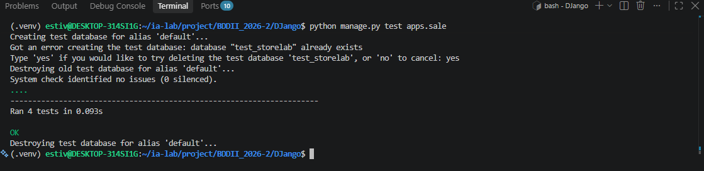
---
## 🛠️ ISS-12 — Consulta y anulación de ventas

### 1. Descripción y Objetivos
Publicar las operaciones de consulta (listado general y detalle individual) y anulación lógica para el recurso `Sale`. Se define `SaleReadViewSet` heredando de `ListModelMixin`, `RetrieveModelMixin`, `DestroyModelMixin` y `GenericViewSet`. Las lecturas optimizan la carga mediante `select_related("client")` y `prefetch_related("lines__product")` garantizando que la consulta del detalle exponga las líneas del pedido manteniendo intacto el precio histórico grabado (`unit_price`). La anulación mediante `DELETE /api/sales/<id>/` invoca la función de dominio `sale.void()`, la cual reintegra las existencias al inventario en el primer llamado y transiciona la venta y sus detalles al estado `inactive`, protegiendo la idempotencia para evitar sumas duplicadas de stock en reintentos.

### 2. Comandos Ejecutados
```bash
# 1. Definir SaleReadViewSet y habilitar GET en SaleCollectionAPIView
cat > apps/sale/views.py <<'EOF'
from rest_framework import mixins, status, viewsets
from rest_framework.permissions import AllowAny
from rest_framework.response import Response
from rest_framework.views import APIView
from apps.sale.models import Sale
from apps.sale.serializers import SaleRegisterSerializer, SaleSerializer

class SaleReadViewSet(
    mixins.ListModelMixin,
    mixins.RetrieveModelMixin,
    mixins.DestroyModelMixin,
    viewsets.GenericViewSet,
):
    permission_classes = [AllowAny]
    serializer_class = SaleSerializer
    lookup_value_converter = "int"

    def get_queryset(self):
        return Sale.objects.select_related("client").prefetch_related("lines__product")

    def perform_destroy(self, instance):
        instance.void()

class SaleRegisterAPIView(APIView):
    permission_classes = [AllowAny]

    def post(self, request):
        serializer = SaleRegisterSerializer(data=request.data)
        serializer.is_valid(raise_exception=True)
        sale = serializer.save()
        sale = Sale.objects.prefetch_related("lines__product").get(pk=sale.pk)
        return Response(SaleSerializer(sale).data, status=status.HTTP_201_CREATED)

class SaleCollectionAPIView(APIView):
    permission_classes = [AllowAny]

    def get(self, request, *args, **kwargs):
        return SaleReadViewSet.as_view({"get": "list"})(request._request, *args, **kwargs)

    def post(self, request, *args, **kwargs):
        handler = SaleRegisterAPIView()
        handler.request = request
        handler.format_kwarg = None
        handler.args = ()
        handler.kwargs = {}
        return handler.post(request)
EOF

# 2. Registrar el endpoint de detalle /api/sales/<int:pk>/
cat > apps/sale/urls.py <<'EOF'
from django.urls import path
from apps.sale.views import SaleCollectionAPIView, SaleReadViewSet

urlpatterns = [
    path("sales/", SaleCollectionAPIView.as_view(), name="sale-collection"),
    path(
        "sales/<int:pk>/",
        SaleReadViewSet.as_view({"get": "retrieve", "delete": "destroy"}),
        name="sale-detail",
    ),
]
EOF

# 3. Incluir pruebas unitarias de consulta, precio histórico e idempotencia
cat > apps/sale/tests.py <<'EOF'
from decimal import Decimal
from unittest.mock import patch
from django.utils import timezone
from rest_framework.test import APITestCase
from apps.client.models import Client
from apps.common.status import RecordStatus
from apps.product.models import Product, ProductType
from apps.sale.models import ProductSale, Sale

class SaleTransactionTests(APITestCase):
    def setUp(self):
        self.buyer = Client.objects.create(name="Comprador", status=RecordStatus.ACTIVE)
        product_type = ProductType.objects.create(name="Abarrote", status=RecordStatus.ACTIVE)
        self.water = Product.objects.create(
            product_type=product_type,
            name="Agua",
            price=Decimal("10.00"),
            stock=5,
            status=RecordStatus.ACTIVE,
        )
        self.bread = Product.objects.create(
            product_type=product_type,
            name="Pan",
            price=Decimal("4.50"),
            stock=2,
            status=RecordStatus.ACTIVE,
        )

    def _payload(self, items, discounts="0.00"):
        return {
            "clientId": self.buyer.id,
            "saleDate": timezone.now().isoformat(),
            "discounts": discounts,
            "items": items,
        }

    def test_register_snapshots_price_and_discounts_stock(self):
        response = self.client.post(
            "/api/sales/",
            self._payload(
                [
                    {"productId": self.water.id, "quantity": 2},
                    {"productId": self.bread.id, "quantity": 1},
                ],
                discounts="1.50",
            ),
            format="json",
        )
        self.assertEqual(response.status_code, 201, response.data)
        self.assertEqual(response.data["tax"], "0.00")
        self.assertEqual(response.data["subtotal"], "24.50")
        self.assertEqual(response.data["total"], "23.00")
        self.assertEqual(response.data["status"], "active")
        water_line = next(
            line for line in response.data["lines"] if line["product"] == self.water.id
        )
        self.assertEqual(water_line["unit_price"], "10.00")
        self.water.refresh_from_db()
        self.bread.refresh_from_db()
        self.assertEqual(self.water.stock, 3)
        self.assertEqual(self.bread.stock, 1)

    def test_insufficient_stock_rolls_back(self):
        response = self.client.post(
            "/api/sales/",
            self._payload([{"productId": self.bread.id, "quantity": 3}]),
            format="json",
        )
        self.assertEqual(response.status_code, 400)
        self.assertEqual(Sale.objects.count(), 0)
        self.bread.refresh_from_db()
        self.assertEqual(self.bread.stock, 2)

    def test_stock_failure_rolls_back_the_sale(self):
        original = Product.save
        def fail_stock(product, *args, **kwargs):
            update_fields = kwargs.get("update_fields")
            if update_fields and "stock" in update_fields:
                raise RuntimeError("fallo de stock")
            return original(product, *args, **kwargs)

        with patch.object(Product, "save", fail_stock):
            with self.assertRaises(RuntimeError):
                self.client.post(
                    "/api/sales/",
                    self._payload([{"productId": self.water.id, "quantity": 1}]),
                    format="json",
                )
        self.assertEqual(Sale.objects.count(), 0)
        self.assertEqual(ProductSale.objects.count(), 0)

    def test_inactive_client_is_rejected(self):
        self.buyer.status = RecordStatus.INACTIVE
        self.buyer.save()
        response = self.client.post(
            "/api/sales/",
            self._payload([{"productId": self.water.id, "quantity": 1}]),
            format="json",
        )
        self.assertEqual(response.status_code, 400)
        self.assertEqual(Sale.objects.count(), 0)

    def test_detail_keeps_historical_price(self):
        response = self.client.post(
            "/api/sales/",
            self._payload([{"productId": self.water.id, "quantity": 1}]),
            format="json",
        )
        Product.objects.filter(pk=self.water.pk).update(price=Decimal("99.00"))
        detail = self.client.get(f"/api/sales/{response.data['id']}/")
        self.assertEqual(detail.status_code, 200)
        self.assertEqual(detail.data["lines"][0]["unit_price"], "10.00")

    def test_list_returns_the_registered_sale(self):
        created = self.client.post(
            "/api/sales/",
            self._payload([{"productId": self.water.id, "quantity": 1}]),
            format="json",
        )
        listed = self.client.get("/api/sales/")
        self.assertEqual(listed.status_code, 200)
        self.assertTrue(any(row["id"] == created.data["id"] for row in listed.data))

    def test_void_restores_stock_once(self):
        created = self.client.post(
            "/api/sales/",
            self._payload([{"productId": self.water.id, "quantity": 2}]),
            format="json",
        )
        sale_id = created.data["id"]
        first = self.client.delete(f"/api/sales/{sale_id}/")
        second = self.client.delete(f"/api/sales/{sale_id}/")
        self.assertEqual(first.status_code, 204)
        self.assertEqual(second.status_code, 204)
        self.water.refresh_from_db()
        self.assertEqual(self.water.stock, 5)
        sale = Sale.objects.get(pk=sale_id)
        self.assertEqual(sale.status, RecordStatus.INACTIVE)
EOF

# 4. Chequeo de consistencia general
python manage.py check
```

### 3. Archivos Creados y Modificados
- **`apps/sale/views.py`**: Adición de `SaleReadViewSet` (hereda de `ListModelMixin`, `RetrieveModelMixin`, `DestroyModelMixin`) delegando la destrucción a `instance.void()`, y habilitación de la acción GET en `SaleCollectionAPIView`.
- **`apps/sale/urls.py`**: Mapeo de la ruta explícita `sales/<int:pk>/` enlazada a las acciones `retrieve` (GET) y `destroy` (DELETE) de `SaleReadViewSet`.
- **`apps/sale/tests.py`**: Incorporación de tres nuevos tests unitarios (`test_detail_keeps_historical_price`, `test_list_returns_the_registered_sale` y `test_void_restores_stock_once`).

### 4. Evidencias
---
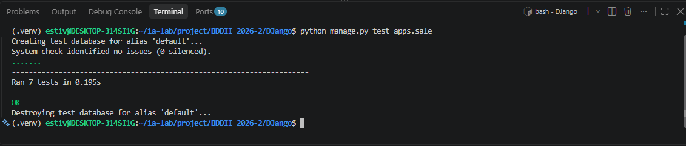
---
## 🛠️ ISS-13 — Django Admin

### 1. Descripción y Objetivos
Registrar las cinco entidades del dominio de negocio (`Client`, `ProductType`, `Product`, `Sale` y `ProductSale`) en el sitio de administración de Django (`django.contrib.admin`). Se configuran vistas personalizadas (`ModelAdmin`) estructurando visualizaciones en cuadrícula con `list_display`, filtros dinámicos con `list_filter`, cuadros de búsqueda con `search_fields` y ordenamiento de registros. Para `Client`, `ProductType` y `Product` se agrupan los formularios mediante `fieldsets`, habilitando edición directa desde lista (`list_editable`) y búsqueda autocompletada (`autocomplete_fields`). En los módulos transaccionales `Sale` y `ProductSale`, se bloquean los permisos de creación (`has_add_permission = False`) y borrado (`has_delete_permission = False`) y se marcan todos los campos como solo lectura (`readonly_fields`), asociando las líneas de venta mediante `ProductSaleInline` para garantizar la inspección de comprobantes sin romper la integridad o reglas de stock.

### 2. Comandos Ejecutados
```bash
# 1. Configurar admin de Client en apps/client/admin.py
cat > apps/client/admin.py <<'EOF'
from django.contrib import admin
from apps.client.models import Client

@admin.register(Client)
class ClientAdmin(admin.ModelAdmin):
    list_display = ("name", "email", "phone", "address", "status", "created_at")
    list_filter = ("status",)
    search_fields = ("name", "email", "phone", "address")
    list_editable = ("status",)
    ordering = ("name", "email")
    readonly_fields = ("created_at", "updated_at")
    fieldsets = (
        ("Información del cliente", {"fields": ("name", "email", "phone", "address")}),
        ("Estado", {"fields": ("status",)}),
        (
            "Auditoría",
            {"fields": ("created_at", "updated_at"), "classes": ("collapse",)},
        ),
    )
EOF

# 2. Configurar admin de Product y ProductType en apps/product/admin.py
cat > apps/product/admin.py <<'EOF'
from django.contrib import admin
from apps.product.models import Product, ProductType

@admin.register(ProductType)
class ProductTypeAdmin(admin.ModelAdmin):
    list_display = ("name", "status", "created_at")
    list_filter = ("status",)
    search_fields = ("name", "description")
    list_editable = ("status",)
    ordering = ("name",)
    readonly_fields = ("created_at", "updated_at")
    fieldsets = (
        (None, {"fields": ("name", "description", "status")}),
        (
            "Auditoría",
            {"fields": ("created_at", "updated_at"), "classes": ("collapse",)},
        ),
    )

@admin.register(Product)
class ProductAdmin(admin.ModelAdmin):
    list_display = ("name", "product_type", "price", "stock", "status")
    list_filter = ("status", "product_type")
    search_fields = ("name", "description")
    list_editable = ("price", "stock", "status")
    ordering = ("name",)
    autocomplete_fields = ("product_type",)
    readonly_fields = ("created_at", "updated_at")
    fieldsets = (
        ("Información", {"fields": ("name", "description", "product_type")}),
        ("Precio y stock", {"fields": ("price", "stock")}),
        ("Estado", {"fields": ("status",)}),
        (
            "Auditoría",
            {"fields": ("created_at", "updated_at"), "classes": ("collapse",)},
        ),
    )

    def get_queryset(self, request):
        return super().get_queryset(request).select_related("product_type")
EOF

# 3. Configurar admin de Sale y ProductSale en apps/sale/admin.py
cat > apps/sale/admin.py <<'EOF'
from django.contrib import admin
from apps.sale.models import ProductSale, Sale

class ProductSaleInline(admin.TabularInline):
    model = ProductSale
    extra = 0
    can_delete = False
    show_change_link = True
    fields = ("product", "quantity", "unit_price", "line_total", "status")
    readonly_fields = ("product", "quantity", "unit_price", "line_total", "status")

    def has_add_permission(self, request, obj=None):
        return False

@admin.register(Sale)
class SaleAdmin(admin.ModelAdmin):
    list_display = (
        "id",
        "client",
        "sale_date",
        "subtotal",
        "tax",
        "discounts",
        "total",
        "status",
    )
    list_filter = ("status", "sale_date")
    search_fields = ("client__name", "client__email")
    ordering = ("-sale_date",)
    date_hierarchy = "sale_date"
    readonly_fields = (
        "client",
        "sale_date",
        "subtotal",
        "tax",
        "discounts",
        "total",
        "status",
        "created_at",
        "updated_at",
    )
    fieldsets = (
        ("Información de la venta", {"fields": ("client", "status")}),
        (
            "Totales",
            {
                "fields": ("subtotal", "tax", "discounts", "total"),
                "classes": ("collapse",),
            },
        ),
        ("Fecha", {"fields": ("sale_date",), "classes": ("collapse",)}),
        (
            "Auditoría",
            {"fields": ("created_at", "updated_at"), "classes": ("collapse",)},
        ),
    )
    inlines = (ProductSaleInline,)

    def has_add_permission(self, request):
        return False

    def has_delete_permission(self, request, obj=None):
        return False

    def get_queryset(self, request):
        return super().get_queryset(request).select_related("client")

@admin.register(ProductSale)
class ProductSaleAdmin(admin.ModelAdmin):
    list_display = ("sale", "product", "quantity", "unit_price", "line_total", "status")
    list_filter = ("status", "sale__sale_date", "product__status")
    search_fields = ("sale__client__name", "product__name")
    ordering = ("-sale__sale_date", "id")
    readonly_fields = (
        "sale",
        "product",
        "quantity",
        "unit_price",
        "line_total",
        "status",
        "created_at",
        "updated_at",
    )
    fieldsets = (
        ("Línea", {"fields": ("sale", "product", "quantity", "unit_price", "line_total")}),
        ("Estado", {"fields": ("status",)}),
        (
            "Auditoría",
            {"fields": ("created_at", "updated_at"), "classes": ("collapse",)},
        ),
    )

    def has_add_permission(self, request):
        return False

    def has_delete_permission(self, request, obj=None):
        return False

    def get_queryset(self, request):
        return super().get_queryset(request).select_related(
            "sale", "sale__client", "product"
        )
EOF

# 4. Crear superusuario para acceso a la interfaz web de administración
python manage.py createsuperuser

# 5. Ejecutar chequeo del sistema
python manage.py check
```

### 3. Archivos Creados y Modificados
- **`apps/client/admin.py`**: Configuración de `ClientAdmin` con filtros de estado, búsqueda por campos de texto y edición rápida de estado.
- **`apps/product/admin.py`**: Configuración de `ProductTypeAdmin` y `ProductAdmin` incorporando `autocomplete_fields` e inyección de `select_related("product_type")` en la consulta.
- **`apps/sale/admin.py`**: Configuración de `SaleAdmin`, `ProductSaleAdmin` y `ProductSaleInline` deshabilitando permisos de alta/borrado y definiendo campos en modo de solo lectura.

### 4. Evidencias
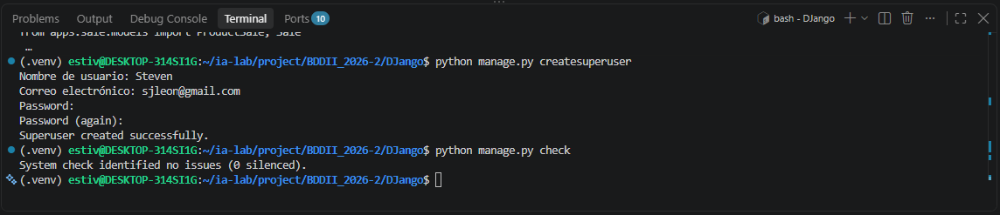
---
## 🛠️ ISS-14 — OpenAPI (Cierre de la Fase I — Business)

### 1. Descripción y Objetivos
Incorporar `drf-spectacular` para la generación automática del esquema OpenAPI v3 a partir de la introspección de modelos, vistas y serializadores. Se registran las rutas de acceso `/api/schema/`, `/api/schema/swagger-ui/` y `/api/schema/redoc/` en la raíz de `config/urls.py`. La configuración en `SPECTACULAR_SETTINGS` integra los hooks `camelize_serializer_fields` y `postprocess_schema_enums` para sincronizar los nombres del contrato con el formato `camelCase` de la API HTTP. Con este paso se da por concluida la **Fase I — Business**, certificando el funcionamiento integral de la lógica de negocio, transacciones e inspección sin autenticación requerida.

### 2. Comandos Ejecutados
```bash
# 1. Instalación de drf-spectacular
source .venv/bin/activate
python -m pip install "drf-spectacular==0.30.0"
python -m pip freeze > requirements.txt

# 2. Registrar drf_spectacular y SPECTACULAR_SETTINGS en config/settings/__init__.py
python -c '
from pathlib import Path

path = Path("config/settings/__init__.py")
content = path.read_text()

if "drf_spectacular" not in content:
    content = content.replace(
        "\"rest_framework\",",
        "\"rest_framework\",\n    \"drf_spectacular\","
    )

if "DEFAULT_SCHEMA_CLASS" not in content:
    content = content.replace(
        "\"DEFAULT_PAGINATION_CLASS\": None,",
        "\"DEFAULT_PAGINATION_CLASS\": None,\n    \"DEFAULT_SCHEMA_CLASS\": \"drf_spectacular.openapi.AutoSchema\","
    )

if "SPECTACULAR_SETTINGS =" not in content:
    extra = """
SPECTACULAR_SETTINGS = {
    "TITLE": "StoreLab API",
    "DESCRIPTION": "API REST de StoreLab.",
    "VERSION": "1.0.0",
    "SERVE_INCLUDE_SCHEMA": False,
    "COMPONENT_SPLIT_REQUEST": True,
    "CAMELIZE_NAMES": True,
    "POSTPROCESSING_HOOKS": [
        "drf_spectacular.hooks.postprocess_schema_enums",
        "drf_spectacular.contrib.djangorestframework_camel_case.camelize_serializer_fields",
    ],
    "SERVE_PERMISSIONS": ["rest_framework.permissions.AllowAny"],
    "SWAGGER_UI_SETTINGS": {"persistAuthorization": True},
}
"""
    content += extra

path.write_text(content)
print("config/settings/__init__.py actualizado con éxito.")
'

# 3. Configurar endpoints de esquema y Swagger UI en config/urls.py
cat > config/urls.py <<'EOF'
from django.contrib import admin
from django.urls import include, path
from drf_spectacular.views import (
    SpectacularAPIView,
    SpectacularRedocView,
    SpectacularSwaggerView,
)

urlpatterns = [
    path("admin/", admin.site.urls),
    path("api/schema/", SpectacularAPIView.as_view(), name="schema"),
    path(
        "api/schema/swagger-ui/",
        SpectacularSwaggerView.as_view(url_name="schema"),
        name="swagger-ui",
    ),
    path(
        "api/schema/redoc/",
        SpectacularRedocView.as_view(url_name="schema"),
        name="redoc",
    ),
    path("api/", include("apps.client.urls")),
    path("api/", include("apps.product.urls")),
    path("api/", include("apps.sale.urls")),
]
EOF

# 4. Validar el esquema generado
python manage.py spectacular --file /tmp/storelab-schema.yml --validate

# 5. Ejecución integral de la suite de la Fase I
python manage.py test apps.client apps.product apps.sale
```

### 3. Archivos Creados y Modificados
- **`config/settings/__init__.py`**: Adición de `drf_spectacular` en `INSTALLED_APPS`, configuración de `DEFAULT_SCHEMA_CLASS` en `REST_FRAMEWORK` y definición de `SPECTACULAR_SETTINGS` con compatibilidad `camelCase`.
- **`config/urls.py`**: Registro de las rutas `/api/schema/`, `/api/schema/swagger-ui/` y `/api/schema/redoc/`.
- **`requirements.txt`**: Congelamiento de dependencias con `drf-spectacular==0.30.0`.

### 4. Evidencias
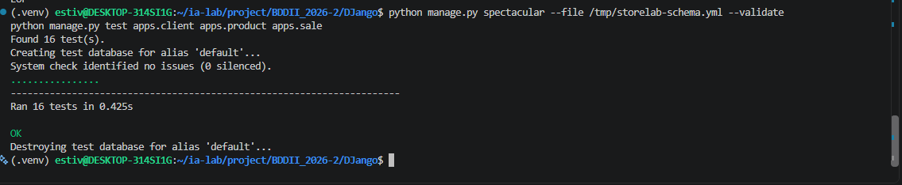
---
## 🛠️ ISS-15 — RefreshToken (Inicio de la Fase II — Security)

### 1. Descripción y Objetivos
Iniciar el subsistema de autenticación persistiendo las sesiones de *refresh token* en la tabla dedicada `refresh_tokens`. A diferencia de la lista negra por defecto de SimpleJWT, StoreLab genera tokens opacos (`secrets.token_urlsafe(48)`) y almacena únicamente su resumen criptográfico SHA-256 (`token_hash`) para prevenir filtraciones en caso de lecturas no autorizadas en la base de datos. Se modelan identificadores de familia de tokens (`family_id`), fechas de expiración (`expires_at`), revocación (`revoked_at`) y trazabilidad de reemplazo (`replaced_by`). La configuración global registra `rest_framework_simplejwt` con vida útil de 60 minutos para *access tokens* y 24 horas para *refresh tokens*.

### 2. Comandos Ejecutados
```bash
# 1. Instalación de djangorestframework-simplejwt
source .venv/bin/activate
python -m pip install "djangorestframework-simplejwt==5.5.1"
python -m pip freeze > requirements.txt

# 2. Crear generador y hasheador de tokens en apps/security/tokens.py
cat > apps/security/tokens.py <<'EOF'
import hashlib
import secrets

def generate_refresh_value():
    return secrets.token_urlsafe(48)

def hash_token(raw_token):
    return hashlib.sha256(raw_token.encode("utf-8")).hexdigest()
EOF

# 3. Definir modelo RefreshToken en apps/security/models.py
python -c '
from pathlib import Path

path = Path("apps/security/models.py")
content = path.read_text()

imports_to_add = []
if "import uuid" not in content:
    imports_to_add.append("import uuid")
if "from django.conf import settings" not in content:
    imports_to_add.append("from django.conf import settings")
if "from django.utils import timezone" not in content:
    imports_to_add.append("from django.utils import timezone")

if imports_to_add:
    content = "\n".join(imports_to_add) + "\n" + content

if "class RefreshToken" not in content:
    refresh_model = """

class RefreshToken(models.Model):
    user = models.ForeignKey(
        settings.AUTH_USER_MODEL,
        on_delete=models.RESTRICT,
        related_name="refresh_tokens",
        db_column="user_id",
    )
    token_hash = models.CharField(max_length=64, unique=True)
    family_id = models.UUIDField(default=uuid.uuid4, editable=False, db_index=True)
    expires_at = models.DateTimeField()
    revoked_at = models.DateTimeField(null=True, blank=True)
    replaced_by = models.ForeignKey(
        "self",
        null=True,
        blank=True,
        on_delete=models.SET_NULL,
        related_name="replacements",
    )
    status = models.CharField(
        max_length=8,
        choices=RecordStatus.choices,
        default=RecordStatus.ACTIVE,
    )
    created_at = models.DateTimeField(auto_now_add=True)
    updated_at = models.DateTimeField(auto_now=True)

    class Meta:
        db_table = "refresh_tokens"
        ordering = ["-created_at"]
        constraints = [
            models.CheckConstraint(
                condition=models.Q(status__in=RecordStatus.values),
                name="refresh_tokens_status_valid",
            )
        ]

    def __str__(self):
        return f"{self.user} {self.family_id}"

    @property
    def is_usable(self):
        return (
            self.status == RecordStatus.ACTIVE
            and self.revoked_at is None
            and self.replaced_by_id is None
            and self.expires_at > timezone.now()
        )

    @classmethod
    def lifetime(cls):
        return settings.SIMPLE_JWT["REFRESH_TOKEN_LIFETIME"]

    @classmethod
    def default_expiry(cls):
        return timezone.now() + cls.lifetime()
"""
    content += refresh_model

path.write_text(content)
print("apps/security/models.py actualizado con éxito.")
'

# 4. Configurar SimpleJWT en config/settings/__init__.py
python -c '
from pathlib import Path

path = Path("config/settings/__init__.py")
content = path.read_text()

if "from datetime import timedelta" not in content:
    content = "from datetime import timedelta\n" + content

if "rest_framework_simplejwt" not in content:
    content = content.replace(
        "\"rest_framework\",",
        "\"rest_framework\",\n    \"rest_framework_simplejwt\","
    )

if "SIMPLE_JWT =" not in content:
    extra = """
SIMPLE_JWT = {
    "ACCESS_TOKEN_LIFETIME": timedelta(minutes=60),
    "REFRESH_TOKEN_LIFETIME": timedelta(days=1),
    "ROTATE_REFRESH_TOKENS": False,
    "BLACKLIST_AFTER_ROTATION": False,
    "UPDATE_LAST_LOGIN": True,
    "ALGORITHM": "HS256",
    "SIGNING_KEY": SECRET_KEY,
    "AUTH_HEADER_TYPES": ("Bearer",),
    "USER_ID_FIELD": "id",
    "USER_ID_CLAIM": "user_id",
}
"""
    content += extra

path.write_text(content)
print("config/settings/__init__.py actualizado con éxito.")
'

# 5. Generar y aplicar migraciones
python manage.py makemigrations security
python manage.py migrate
python manage.py check
```

### 3. Archivos Creados y Modificados
- **`apps/security/tokens.py`**: Funciones `generate_refresh_value()` y `hash_token()` para hashing SHA-256 de tokens de refresco.
- **`apps/security/models.py`**: Incorporación de la clase `RefreshToken` con relaciones a usuario, hashing único, familias de tokens e indicadores de validez (`is_usable`).
- **`config/settings/__init__.py`**: Inclusión de `rest_framework_simplejwt` en `INSTALLED_APPS` y parámetro `SIMPLE_JWT`.
- **`apps/security/migrations/`**: Creación y ejecución del script de migración para la tabla `refresh_tokens`.

### 4. Evidencias
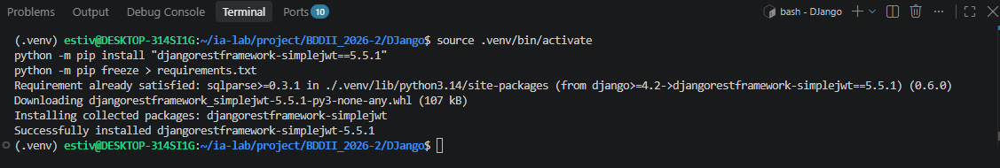
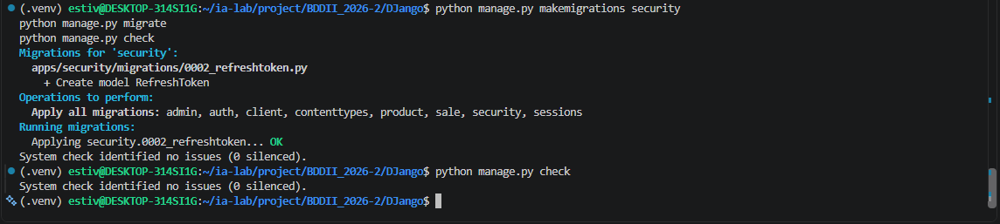
---
## 🛠️ ISS-16 — Role, RoleUser, Resource y ResourceRole

### 1. Descripción y Objetivos
Modelar la matriz de control de acceso basado en roles (RBAC) propia de StoreLab sin depender de las tablas `auth_group` o `auth_permission` por defecto de Django. Se implementan los modelos `Role` (`roles`), `RoleUser` (`role_users`), `Resource` (`resources`) y `ResourceRole` (`resource_roles`), asociando métodos HTTP (`GET`, `POST`, `PUT`, `PATCH`, `DELETE`) y patrones de rutas dinámicas (e.g., `api/clients/<int:pk>/`). Todos los modelos nacen con estado por defecto `inactive` y aplican restricciones de clave foránea `RESTRICT`, así como restricciones de unicidad (`UniqueConstraint`) para evitar duplicidad en asignaciones de rol-usuario, recurso-rol y método-ruta.

### 2. Comandos Ejecutados
```bash
# 1. Agregar las entidades RBAC a apps/security/models.py
python -c '
from pathlib import Path

path = Path("apps/security/models.py")
content = path.read_text()

if "class HttpMethod" not in content:
    extra_models = """

class HttpMethod(models.TextChoices):
    GET = "GET", "GET"
    POST = "POST", "POST"
    PUT = "PUT", "PUT"
    PATCH = "PATCH", "PATCH"
    DELETE = "DELETE", "DELETE"

class Role(models.Model):
    name = models.CharField(max_length=100, unique=True)
    description = models.CharField(max_length=255, null=True, blank=True)
    status = models.CharField(
        max_length=8, choices=RecordStatus.choices, default=RecordStatus.INACTIVE
    )
    created_at = models.DateTimeField(auto_now_add=True)
    updated_at = models.DateTimeField(auto_now=True)

    class Meta:
        db_table = "roles"
        constraints = [
            models.CheckConstraint(
                condition=models.Q(status__in=RecordStatus.values),
                name="roles_status_valid",
            )
        ]

    def __str__(self):
        return self.name

class RoleUser(models.Model):
    role = models.ForeignKey(Role, on_delete=models.RESTRICT, related_name="assignments")
    user = models.ForeignKey(
        settings.AUTH_USER_MODEL, on_delete=models.RESTRICT, related_name="role_links"
    )
    status = models.CharField(
        max_length=8, choices=RecordStatus.choices, default=RecordStatus.INACTIVE
    )
    created_at = models.DateTimeField(auto_now_add=True)
    updated_at = models.DateTimeField(auto_now=True)

    class Meta:
        db_table = "role_users"
        constraints = [
            models.UniqueConstraint(fields=["role", "user"], name="role_user_unique"),
            models.CheckConstraint(
                condition=models.Q(status__in=RecordStatus.values),
                name="role_users_status_valid",
            ),
        ]

class Resource(models.Model):
    name = models.CharField(max_length=150)
    method = models.CharField(max_length=10, choices=HttpMethod.choices)
    route = models.CharField(max_length=255)
    status = models.CharField(
        max_length=8, choices=RecordStatus.choices, default=RecordStatus.INACTIVE
    )
    created_at = models.DateTimeField(auto_now_add=True)
    updated_at = models.DateTimeField(auto_now=True)

    class Meta:
        db_table = "resources"
        constraints = [
            models.UniqueConstraint(fields=["method", "route"], name="resource_method_route_uniq"),
            models.CheckConstraint(
                condition=models.Q(status__in=RecordStatus.values),
                name="resources_status_valid",
            ),
        ]

    def __str__(self):
        return f"{self.method} {self.route}"

class ResourceRole(models.Model):
    resource = models.ForeignKey(Resource, on_delete=models.RESTRICT, related_name="grants")
    role = models.ForeignKey(Role, on_delete=models.RESTRICT, related_name="grants")
    status = models.CharField(
        max_length=8, choices=RecordStatus.choices, default=RecordStatus.INACTIVE
    )
    created_at = models.DateTimeField(auto_now_add=True)
    updated_at = models.DateTimeField(auto_now=True)

    class Meta:
        db_table = "resource_roles"
        constraints = [
            models.UniqueConstraint(fields=["resource", "role"], name="resource_role_unique"),
            models.CheckConstraint(
                condition=models.Q(status__in=RecordStatus.values),
                name="resource_roles_status_valid",
            ),
        ]
"""
    content += extra_models

path.write_text(content)
print("apps/security/models.py actualizado con los modelos RBAC con éxito.")
'

# 2. Generar y aplicar migraciones en el esquema
python manage.py makemigrations security
python manage.py migrate

# 3. Comprobar consistencia
python manage.py check
```

### 3. Archivos Creados y Modificados
- **`apps/security/models.py`**: Definición de la enumeración `HttpMethod` y de los modelos `Role`, `RoleUser`, `Resource` y `ResourceRole` con restricciones de integridad relacional.
- **`apps/security/migrations/`**: Generación y ejecución del script de migración correspondiente a las tablas del sistema de autorización.

### 4. Evidencias
migracion 
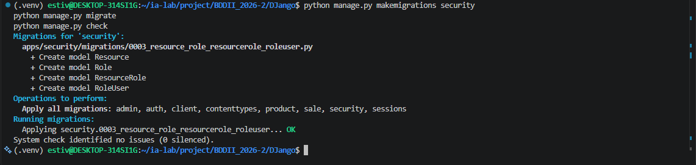
---
## 🛠️ ISS-17 — Login OPEN

### 1. Descripción y Objetivos
Publicar el endpoint público de autenticación `/api/auth/login/` mediante `LoginAPIView`, habilitando el inicio de sesión abierto (`AllowAny` y `authentication_classes = []`) mediante nombre de usuario (`username`) o dirección de correo electrónico (`email`) insensible a mayúsculas/minúsculas. Ante credenciales válidas y usuario activo (`status='active'`), la vista genera un *Access Token* JWT con vigencia de 60 minutos mediante `AccessToken.for_user(user)` y un *Refresh Token* opaco cuya clave hasheada SHA-256 se persiste en la tabla `refresh_tokens`. Si el usuario se encuentra inactivo, no existe o la contraseña es incorrecta, la API retorna una respuesta uniforme de error `401 Unauthorized`.

### 2. Comandos Ejecutados
```bash
# 1. Crear el auxiliar de testing en apps/common/testing.py
mkdir -p apps/common
cat > apps/common/testing.py <<'EOF'
from apps.common.status import RecordStatus
from apps.security.models import User

PASSWORD = "StoreLab-Test-1"

def create_active_user(username="ana", email="ana@storelab.test", password=PASSWORD):
    return User.objects.create_user(
        username=username,
        email=email,
        password=password,
        status=RecordStatus.ACTIVE,
    )
EOF

# 2. Definir serializadores de autenticación en apps/security/serializers.py
cat > apps/security/serializers.py <<'EOF'
from rest_framework import serializers

class LoginSerializer(serializers.Serializer):
    username = serializers.CharField(required=False, allow_blank=False)
    email = serializers.EmailField(required=False)
    password = serializers.CharField(write_only=True)

    def validate(self, attrs):
        if not attrs.get("username") and not attrs.get("email"):
            raise serializers.ValidationError(
                "Informe username o email junto con password."
            )
        return attrs

class RefreshSerializer(serializers.Serializer):
    refresh = serializers.CharField()

class LogoutSerializer(serializers.Serializer):
    refresh = serializers.CharField()

class TokenPairSerializer(serializers.Serializer):
    access = serializers.CharField()
    refresh = serializers.CharField()
    token_type = serializers.CharField()
    access_expires_in = serializers.IntegerField()
EOF

# 3. Definir la vista LoginAPIView en apps/security/auth_views.py
cat > apps/security/auth_views.py <<'EOF'
import uuid
from django.conf import settings
from django.contrib.auth import get_user_model
from django.utils import timezone
from rest_framework import status
from rest_framework.permissions import AllowAny
from rest_framework.response import Response
from rest_framework.views import APIView
from rest_framework_simplejwt.tokens import AccessToken
from drf_spectacular.utils import extend_schema

from apps.common.status import RecordStatus
from apps.security.models import RefreshToken
from apps.security.serializers import LoginSerializer, TokenPairSerializer
from apps.security.tokens import generate_refresh_value, hash_token

User = get_user_model()

def token_payload(user, raw_refresh):
    access = AccessToken.for_user(user)
    lifetime = int(settings.SIMPLE_JWT["ACCESS_TOKEN_LIFETIME"].total_seconds())
    return {
        "access": str(access),
        "refresh": raw_refresh,
        "token_type": "Bearer",
        "access_expires_in": lifetime,
    }

def issue_refresh(user, family_id=None):
    raw_refresh = generate_refresh_value()
    stored = RefreshToken.objects.create(
        user=user,
        token_hash=hash_token(raw_refresh),
        family_id=family_id or uuid.uuid4(),
        expires_at=RefreshToken.default_expiry(),
        status=RecordStatus.ACTIVE,
    )
    return stored, raw_refresh

def _find_user(username, email):
    if username and email:
        return User.objects.filter(username=username, email__iexact=email).first()
    if username:
        return User.objects.filter(username=username).first()
    if email:
        return User.objects.filter(email__iexact=email).first()
    return None

class LoginAPIView(APIView):
    authentication_classes = []
    permission_classes = [AllowAny]

    @extend_schema(
        request=LoginSerializer,
        responses={200: TokenPairSerializer},
        operation_id="auth_login",
    )
    def post(self, request):
        serializer = LoginSerializer(data=request.data)
        serializer.is_valid(raise_exception=True)
        data = serializer.validated_data
        user = _find_user(data.get("username"), data.get("email"))
        invalid = Response(
            {"detail": "Credenciales inválidas."},
            status=status.HTTP_401_UNAUTHORIZED,
        )
        if user is None or user.status != RecordStatus.ACTIVE:
            return invalid
        if not user.check_password(data["password"]):
            return invalid
        _stored, raw_refresh = issue_refresh(user)
        return Response(token_payload(user, raw_refresh), status=status.HTTP_200_OK)
EOF

# 4. Configurar enrutador en apps/security/urls.py
cat > apps/security/urls.py <<'EOF'
from django.urls import path
from apps.security.auth_views import LoginAPIView

urlpatterns = [
    path("auth/login/", LoginAPIView.as_view(), name="auth-login"),
]
EOF

# 5. Mapear enrutador en config/urls.py
cat > config/urls.py <<'EOF'
from django.contrib import admin
from django.urls import include, path
from drf_spectacular.views import (
    SpectacularAPIView,
    SpectacularRedocView,
    SpectacularSwaggerView,
)

urlpatterns = [
    path("admin/", admin.site.urls),
    path("api/schema/", SpectacularAPIView.as_view(), name="schema"),
    path(
        "api/schema/swagger-ui/",
        SpectacularSwaggerView.as_view(url_name="schema"),
        name="swagger-ui",
    ),
    path(
        "api/schema/redoc/",
        SpectacularRedocView.as_view(url_name="schema"),
        name="redoc",
    ),
    path("api/", include("apps.client.urls")),
    path("api/", include("apps.product.urls")),
    path("api/", include("apps.sale.urls")),
    path("api/", include("apps.security.urls")),
]
EOF

# 6. Definir pruebas de flujo de autenticación en apps/security/tests.py
python -c '
from pathlib import Path

path = Path("apps/security/tests.py")
content = path.read_text()

if "AuthFlowTests" not in content:
    extra_imports = """
from rest_framework import status
from rest_framework.test import APITestCase
from apps.common.status import RecordStatus
from apps.common.testing import PASSWORD, create_active_user
from apps.security.models import RefreshToken
from apps.security.tokens import hash_token
"""
    content = extra_imports + "\n" + content

    tests_class = """

class AuthFlowTests(APITestCase):
    def setUp(self):
        self.user = create_active_user()

    def test_login_with_username_and_email(self):
        by_username = self.client.post(
            "/api/auth/login/",
            {"username": "ana", "password": PASSWORD},
            format="json",
        )
        self.assertEqual(by_username.status_code, status.HTTP_200_OK)
        self.assertIn("access", by_username.data)
        self.assertIn("refresh", by_username.data)
        self.assertNotIn("password", by_username.data)
        stored = RefreshToken.objects.get()
        self.assertEqual(stored.token_hash, hash_token(by_username.data["refresh"]))
        by_email = self.client.post(
            "/api/auth/login/",
            {"email": "ANA@storelab.test", "password": PASSWORD},
            format="json",
        )
        self.assertEqual(by_email.status_code, status.HTTP_200_OK)

    def test_inactive_user_and_bad_password_are_401(self):
        self.user.status = RecordStatus.INACTIVE
        self.user.save()
        inactive = self.client.post(
            "/api/auth/login/",
            {"username": "ana", "password": PASSWORD},
            format="json",
        )
        self.assertEqual(inactive.status_code, status.HTTP_401_UNAUTHORIZED)
"""
    content += tests_class

path.write_text(content)
print("apps/security/tests.py actualizado con AuthFlowTests.")
'

# 7. Verificación de integridad y ejecución de pruebas
python manage.py check
python manage.py test apps.security.tests.AuthFlowTests
```

### 3. Archivos Creados y Modificados
- **`apps/common/testing.py`**: Creación de utilidades de desarrollo y pruebas (`PASSWORD`, `create_active_user()`).
- **`apps/security/serializers.py`**: Adición de `LoginSerializer`, `RefreshSerializer`, `LogoutSerializer` y `TokenPairSerializer`.
- **`apps/security/auth_views.py`**: Implementación de `LoginAPIView`, `token_payload()` e `issue_refresh()`.
- **`apps/security/urls.py`**: Declaración de la ruta `auth/login/`.
- **`config/urls.py`**: Inclusión del módulo `apps.security.urls`.
- **`apps/security/tests.py`**: Incorporación de `AuthFlowTests` para validar inicio de sesión con usuario, email, respuestas HTTP 401 para usuarios inactivos o contraseñas erróneas, y almacenamiento seguro del hash del refresh token.

### 4. Evidencias
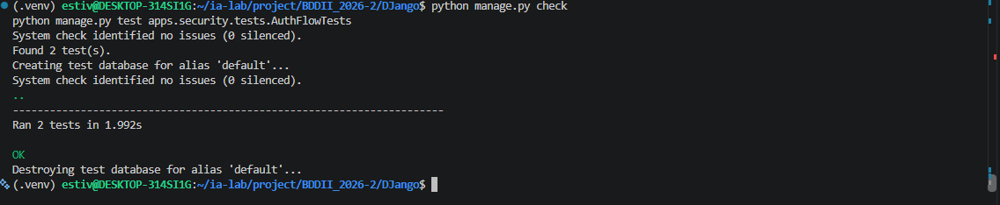
---
## 🛠️ ISS-18 — Refresh con rotación

### 1. Descripción y Objetivos
Implementar la rotación estricta de tokens de refresco y el mecanismo de detección de reutilización en el endpoint `/api/auth/refresh/` mediante `RefreshAPIView`. La vista opera en modo abierto (`AllowAny`) localizando el registro del token en la base de datos mediante su resumen SHA-256 en un bloque con bloqueo pesimista `select_for_update()`. Al recibir un token válido y no expirado, se emite un nuevo par de tokens conservando el mismo `family_id` y enlazando el token anterior como reemplazado (`replaced_by`). Si se detecta un intento de reutilización de un token que ya fue rotado, inactivado o revocado, el sistema asume un compromiso de seguridad y revoca inmediatamente toda la familia de tokens asociada (`family_id`), obligando a todas las sesiones activas de esa familia a autenticarse nuevamente mediante login.

### 2. Comandos Ejecutados
```bash
# 1. Definir RefreshAPIView en apps/security/auth_views.py
cat > apps/security/auth_views.py <<'EOF'
import uuid
from django.conf import settings
from django.contrib.auth import get_user_model
from django.db import transaction
from django.utils import timezone
from rest_framework import status
from rest_framework.permissions import AllowAny
from rest_framework.response import Response
from rest_framework.views import APIView
from rest_framework_simplejwt.tokens import AccessToken
from drf_spectacular.utils import extend_schema

from apps.common.status import RecordStatus
from apps.security.models import RefreshToken
from apps.security.serializers import (
    LoginSerializer,
    RefreshSerializer,
    TokenPairSerializer,
)
from apps.security.tokens import generate_refresh_value, hash_token

User = get_user_model()

def token_payload(user, raw_refresh):
    access = AccessToken.for_user(user)
    lifetime = int(settings.SIMPLE_JWT["ACCESS_TOKEN_LIFETIME"].total_seconds())
    return {
        "access": str(access),
        "refresh": raw_refresh,
        "token_type": "Bearer",
        "access_expires_in": lifetime,
    }

def issue_refresh(user, family_id=None):
    raw_refresh = generate_refresh_value()
    stored = RefreshToken.objects.create(
        user=user,
        token_hash=hash_token(raw_refresh),
        family_id=family_id or uuid.uuid4(),
        expires_at=RefreshToken.default_expiry(),
        status=RecordStatus.ACTIVE,
    )
    return stored, raw_refresh

class LoginAPIView(APIView):
    authentication_classes = []
    permission_classes = [AllowAny]

    @extend_schema(
        request=LoginSerializer,
        responses={200: TokenPairSerializer},
        operation_id="auth_login",
    )
    def post(self, request):
        serializer = LoginSerializer(data=request.data)
        serializer.is_valid(raise_exception=True)
        data = serializer.validated_data
        user = _find_user(data.get("username"), data.get("email"))
        invalid = Response(
            {"detail": "Credenciales inválidas."},
            status=status.HTTP_401_UNAUTHORIZED,
        )
        if user is None or user.status != RecordStatus.ACTIVE:
            return invalid
        if not user.check_password(data["password"]):
            return invalid
        _stored, raw_refresh = issue_refresh(user)
        return Response(token_payload(user, raw_refresh), status=status.HTTP_200_OK)

class RefreshAPIView(APIView):
    authentication_classes = []
    permission_classes = [AllowAny]

    @extend_schema(
        request=RefreshSerializer,
        responses={200: TokenPairSerializer},
        operation_id="auth_refresh",
    )
    def post(self, request):
        serializer = RefreshSerializer(data=request.data)
        serializer.is_valid(raise_exception=True)
        raw_token = serializer.validated_data["refresh"]
        token_hash_val = hash_token(raw_token)

        invalid_response = Response(
            {"detail": "Token no válido o expirado."},
            status=status.HTTP_401_UNAUTHORIZED,
        )

        with transaction.atomic():
            token = (
                RefreshToken.objects.select_for_update()
                .select_related("user")
                .filter(token_hash=token_hash_val)
                .first()
            )

            if not token:
                return invalid_response

            if (
                token.replaced_by_id is not None
                or token.revoked_at is not None
                or token.status != RecordStatus.ACTIVE
            ):
                RefreshToken.objects.filter(family_id=token.family_id).update(
                    status=RecordStatus.INACTIVE,
                    revoked_at=timezone.now(),
                )
                return invalid_response

            if token.expires_at <= timezone.now() or token.user.status != RecordStatus.ACTIVE:
                token.status = RecordStatus.INACTIVE
                token.save(update_fields=["status", "updated_at"])
                return invalid_response

            new_stored, new_raw_refresh = issue_refresh(
                user=token.user,
                family_id=token.family_id,
            )
            token.replaced_by = new_stored
            token.status = RecordStatus.INACTIVE
            token.save(update_fields=["replaced_by", "status", "updated_at"])

            return Response(
                token_payload(token.user, new_raw_refresh),
                status=status.HTTP_200_OK,
            )

def _find_user(username, email):
    if username and email:
        return User.objects.filter(username=username, email__iexact=email).first()
    if username:
        return User.objects.filter(username=username).first()
    if email:
        return User.objects.filter(email__iexact=email).first()
    return None
EOF

# 2. Registrar endpoint auth/refresh/ en apps/security/urls.py
cat > apps/security/urls.py <<'EOF'
from django.urls import path
from apps.security.auth_views import LoginAPIView, RefreshAPIView

urlpatterns = [
    path("auth/login/", LoginAPIView.as_view(), name="auth-login"),
    path("auth/refresh/", RefreshAPIView.as_view(), name="auth-refresh"),
]
EOF

# 3. Agregar test de rotación y revocación de familia en apps/security/tests.py
cat > apps/security/tests.py <<'EOF'
from rest_framework import status
from rest_framework.test import APITestCase
from apps.common.status import RecordStatus
from apps.common.testing import PASSWORD, create_active_user
from apps.security.models import RefreshToken
from apps.security.tokens import hash_token

class AuthFlowTests(APITestCase):
    def setUp(self):
        self.user = create_active_user()

    def test_login_with_username_and_email(self):
        by_username = self.client.post(
            "/api/auth/login/",
            {"username": "ana", "password": PASSWORD},
            format="json",
        )
        self.assertEqual(by_username.status_code, status.HTTP_200_OK)
        self.assertIn("access", by_username.data)
        self.assertIn("refresh", by_username.data)
        self.assertNotIn("password", by_username.data)
        stored = RefreshToken.objects.get()
        self.assertEqual(stored.token_hash, hash_token(by_username.data["refresh"]))
        by_email = self.client.post(
            "/api/auth/login/",
            {"email": "ANA@storelab.test", "password": PASSWORD},
            format="json",
        )
        self.assertEqual(by_email.status_code, status.HTTP_200_OK)

    def test_inactive_user_and_bad_password_are_401(self):
        self.user.status = RecordStatus.INACTIVE
        self.user.save()
        inactive = self.client.post(
            "/api/auth/login/",
            {"username": "ana", "password": PASSWORD},
            format="json",
        )
        self.assertEqual(inactive.status_code, status.HTTP_401_UNAUTHORIZED)

    def test_refresh_rotates_and_reuse_revokes_family(self):
        login = self.client.post(
            "/api/auth/login/",
            {"username": "ana", "password": PASSWORD},
            format="json",
        )
        first = login.data["refresh"]
        rotated = self.client.post("/api/auth/refresh/", {"refresh": first}, format="json")
        self.assertEqual(rotated.status_code, status.HTTP_200_OK)
        second = rotated.data["refresh"]
        self.assertNotEqual(first, second)
        reused = self.client.post("/api/auth/refresh/", {"refresh": first}, format="json")
        self.assertEqual(reused.status_code, status.HTTP_401_UNAUTHORIZED)
        after_reuse = self.client.post("/api/auth/refresh/", {"refresh": second}, format="json")
        self.assertEqual(after_reuse.status_code, status.HTTP_401_UNAUTHORIZED)
EOF

# 4. Verificación de integridad y ejecución de pruebas
python manage.py check
python manage.py test apps.security.tests.AuthFlowTests.test_refresh_rotates_and_reuse_revokes_family
```

### 3. Archivos Creados y Modificados
- **`apps/security/auth_views.py`**: Implementación de `RefreshAPIView` con trazabilidad por `replaced_by`, expiración e invalidación de familias enteras (`family_id`).
- **`apps/security/urls.py`**: Registro de la ruta `auth/refresh/`.
- **`apps/security/tests.py`**: Adición de `test_refresh_rotates_and_reuse_revokes_family` en `AuthFlowTests`.

### 4. Evidencias
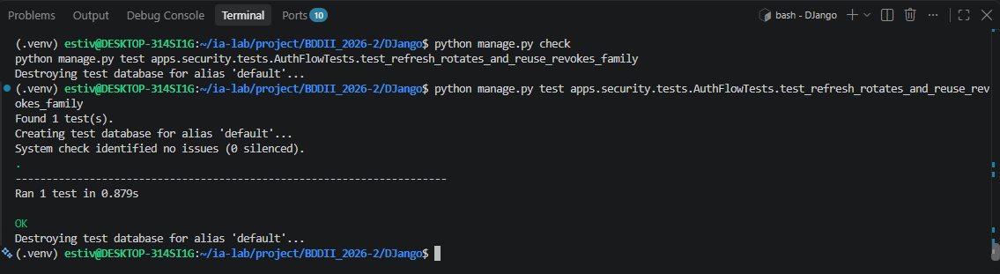
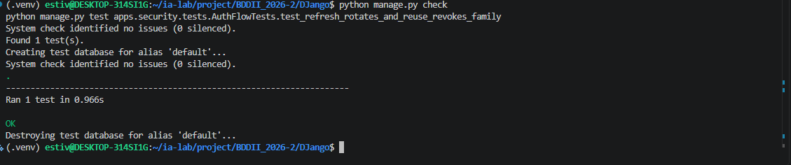
---
## 🛠️ ISS-19 — Logout

### 1. Descripción y Objetivos
Implementar la invalidación explícita de la sesión mediante el endpoint `/api/auth/logout/` expuesto por `LogoutAPIView`. El endpoint opera en acceso abierto (`AllowAny`) recibiendo únicamente el token de refresco (`refresh`). La vista busca el hash SHA-256 en la tabla `refresh_tokens`. Si el token no existe responde `401 Unauthorized`; si el token ya fue reemplazado anteriormente, revoca inmediatamente toda la familia (`family_id`) y responde `401 Unauthorized`. En cualquier otro caso, la sesión transiciona a `status='inactive'`, registra la fecha exacta en `revoked_at` y devuelve una respuesta vacía `204 No Content`, garantizando que dicho token no pueda volver a ser utilizado para renovar credenciales en `/api/auth/refresh/`.

### 2. Comandos Ejecutados
```bash
# 1. Definir LogoutAPIView en apps/security/auth_views.py
cat > apps/security/auth_views.py <<'EOF'
import uuid
from django.conf import settings
from django.contrib.auth import get_user_model
from django.db import transaction
from django.utils import timezone
from rest_framework import status
from rest_framework.permissions import AllowAny
from rest_framework.response import Response
from rest_framework.views import APIView
from rest_framework_simplejwt.tokens import AccessToken
from drf_spectacular.utils import extend_schema

from apps.common.status import RecordStatus
from apps.security.models import RefreshToken
from apps.security.serializers import (
    LoginSerializer,
    LogoutSerializer,
    RefreshSerializer,
    TokenPairSerializer,
)
from apps.security.tokens import generate_refresh_value, hash_token

User = get_user_model()

def token_payload(user, raw_refresh):
    access = AccessToken.for_user(user)
    lifetime = int(settings.SIMPLE_JWT["ACCESS_TOKEN_LIFETIME"].total_seconds())
    return {
        "access": str(access),
        "refresh": raw_refresh,
        "token_type": "Bearer",
        "access_expires_in": lifetime,
    }

def issue_refresh(user, family_id=None):
    raw_refresh = generate_refresh_value()
    stored = RefreshToken.objects.create(
        user=user,
        token_hash=hash_token(raw_refresh),
        family_id=family_id or uuid.uuid4(),
        expires_at=RefreshToken.default_expiry(),
        status=RecordStatus.ACTIVE,
    )
    return stored, raw_refresh

class LoginAPIView(APIView):
    authentication_classes = []
    permission_classes = [AllowAny]

    @extend_schema(
        request=LoginSerializer,
        responses={200: TokenPairSerializer},
        operation_id="auth_login",
    )
    def post(self, request):
        serializer = LoginSerializer(data=request.data)
        serializer.is_valid(raise_exception=True)
        data = serializer.validated_data
        user = _find_user(data.get("username"), data.get("email"))
        invalid = Response(
            {"detail": "Credenciales inválidas."},
            status=status.HTTP_401_UNAUTHORIZED,
        )
        if user is None or user.status != RecordStatus.ACTIVE:
            return invalid
        if not user.check_password(data["password"]):
            return invalid
        _stored, raw_refresh = issue_refresh(user)
        return Response(token_payload(user, raw_refresh), status=status.HTTP_200_OK)

class RefreshAPIView(APIView):
    authentication_classes = []
    permission_classes = [AllowAny]

    @extend_schema(
        request=RefreshSerializer,
        responses={200: TokenPairSerializer},
        operation_id="auth_refresh",
    )
    def post(self, request):
        serializer = RefreshSerializer(data=request.data)
        serializer.is_valid(raise_exception=True)
        raw_token = serializer.validated_data["refresh"]
        token_hash_val = hash_token(raw_token)

        invalid_response = Response(
            {"detail": "Token no válido o expirado."},
            status=status.HTTP_401_UNAUTHORIZED,
        )

        with transaction.atomic():
            token = (
                RefreshToken.objects.select_for_update()
                .select_related("user")
                .filter(token_hash=token_hash_val)
                .first()
            )

            if not token:
                return invalid_response

            if (
                token.replaced_by_id is not None
                or token.revoked_at is not None
                or token.status != RecordStatus.ACTIVE
            ):
                RefreshToken.objects.filter(family_id=token.family_id).update(
                    status=RecordStatus.INACTIVE,
                    revoked_at=timezone.now(),
                )
                return invalid_response

            if token.expires_at <= timezone.now() or token.user.status != RecordStatus.ACTIVE:
                token.status = RecordStatus.INACTIVE
                token.save(update_fields=["status", "updated_at"])
                return invalid_response

            new_stored, new_raw_refresh = issue_refresh(
                user=token.user,
                family_id=token.family_id,
            )
            token.replaced_by = new_stored
            token.status = RecordStatus.INACTIVE
            token.save(update_fields=["replaced_by", "status", "updated_at"])

            return Response(
                token_payload(token.user, new_raw_refresh),
                status=status.HTTP_200_OK,
            )

class LogoutAPIView(APIView):
    authentication_classes = []
    permission_classes = [AllowAny]

    @extend_schema(
        request=LogoutSerializer,
        responses={204: None},
        operation_id="auth_logout",
    )
    def post(self, request):
        serializer = LogoutSerializer(data=request.data)
        serializer.is_valid(raise_exception=True)
        raw_token = serializer.validated_data["refresh"]
        token_hash_val = hash_token(raw_token)

        invalid_response = Response(
            {"detail": "Token no válido o expirado."},
            status=status.HTTP_401_UNAUTHORIZED,
        )

        with transaction.atomic():
            token = (
                RefreshToken.objects.select_for_update()
                .filter(token_hash=token_hash_val)
                .first()
            )

            if not token:
                return invalid_response

            if token.replaced_by_id is not None:
                RefreshToken.objects.filter(family_id=token.family_id).update(
                    status=RecordStatus.INACTIVE,
                    revoked_at=timezone.now(),
                )
                return invalid_response

            token.status = RecordStatus.INACTIVE
            if not token.revoked_at:
                token.revoked_at = timezone.now()
            token.save(update_fields=["status", "revoked_at", "updated_at"])

            return Response(status=status.HTTP_204_NO_CONTENT)

def _find_user(username, email):
    if username and email:
        return User.objects.filter(username=username, email__iexact=email).first()
    if username:
        return User.objects.filter(username=username).first()
    if email:
        return User.objects.filter(email__iexact=email).first()
    return None
EOF

# 2. Configurar enrutador auth/logout/ en apps/security/urls.py
cat > apps/security/urls.py <<'EOF'
from django.urls import path
from apps.security.auth_views import LoginAPIView, LogoutAPIView, RefreshAPIView

urlpatterns = [
    path("auth/login/", LoginAPIView.as_view(), name="auth-login"),
    path("auth/refresh/", RefreshAPIView.as_view(), name="auth-refresh"),
    path("auth/logout/", LogoutAPIView.as_view(), name="auth-logout"),
]
EOF

# 3. Incluir prueba de invalidación por logout en apps/security/tests.py
cat > apps/security/tests.py <<'EOF'
from rest_framework import status
from rest_framework.test import APITestCase
from apps.common.status import RecordStatus
from apps.common.testing import PASSWORD, create_active_user
from apps.security.models import RefreshToken
from apps.security.tokens import hash_token

class AuthFlowTests(APITestCase):
    def setUp(self):
        self.user = create_active_user()

    def test_login_with_username_and_email(self):
        by_username = self.client.post(
            "/api/auth/login/",
            {"username": "ana", "password": PASSWORD},
            format="json",
        )
        self.assertEqual(by_username.status_code, status.HTTP_200_OK)
        self.assertIn("access", by_username.data)
        self.assertIn("refresh", by_username.data)
        self.assertNotIn("password", by_username.data)
        stored = RefreshToken.objects.get()
        self.assertEqual(stored.token_hash, hash_token(by_username.data["refresh"]))
        by_email = self.client.post(
            "/api/auth/login/",
            {"email": "ANA@storelab.test", "password": PASSWORD},
            format="json",
        )
        self.assertEqual(by_email.status_code, status.HTTP_200_OK)

    def test_inactive_user_and_bad_password_are_401(self):
        self.user.status = RecordStatus.INACTIVE
        self.user.save()
        inactive = self.client.post(
            "/api/auth/login/",
            {"username": "ana", "password": PASSWORD},
            format="json",
        )
        self.assertEqual(inactive.status_code, status.HTTP_401_UNAUTHORIZED)

    def test_refresh_rotates_and_reuse_revokes_family(self):
        login = self.client.post(
            "/api/auth/login/",
            {"username": "ana", "password": PASSWORD},
            format="json",
        )
        first = login.data["refresh"]
        rotated = self.client.post("/api/auth/refresh/", {"refresh": first}, format="json")
        self.assertEqual(rotated.status_code, status.HTTP_200_OK)
        second = rotated.data["refresh"]
        self.assertNotEqual(first, second)
        reused = self.client.post("/api/auth/refresh/", {"refresh": first}, format="json")
        self.assertEqual(reused.status_code, status.HTTP_401_UNAUTHORIZED)
        after_reuse = self.client.post("/api/auth/refresh/", {"refresh": second}, format="json")
        self.assertEqual(after_reuse.status_code, status.HTTP_401_UNAUTHORIZED)

    def test_logout_invalidates_refresh(self):
        login = self.client.post(
            "/api/auth/login/",
            {"username": "ana", "password": PASSWORD},
            format="json",
        )
        raw = login.data["refresh"]
        logout = self.client.post("/api/auth/logout/", {"refresh": raw}, format="json")
        self.assertEqual(logout.status_code, status.HTTP_204_NO_CONTENT)
        again = self.client.post("/api/auth/refresh/", {"refresh": raw}, format="json")
        self.assertEqual(again.status_code, status.HTTP_401_UNAUTHORIZED)
EOF

# 4. Verificación de integridad y ejecución de pruebas
python manage.py check
python manage.py test apps.security.tests.AuthFlowTests.test_logout_invalidates_refresh
```

### 3. Archivos Creados y Modificados
- **`apps/security/auth_views.py`**: Adición de `LogoutAPIView` con marcado de estado `inactive` e insersión de `revoked_at`.
- **`apps/security/urls.py`**: Mapeo de la ruta `auth/logout/`.
- **`apps/security/tests.py`**: Adición de `test_logout_invalidates_refresh` en `AuthFlowTests`.

### 4. Evidencias
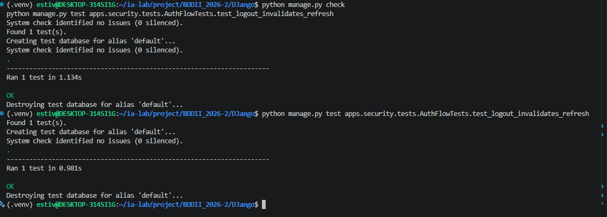
---
## 🛠️ ISS-20 — Perfil JWT con token

### 1. Descripción y Objetivos
Implementar la autenticación por token JWT personalizada a través de `StoreLabJWTAuthentication` heredando de `JWTAuthentication`. Esta clase extiende la validación de firma y fecha de expiración del *Access Token*, verificando adicionalmente en la base de datos que el usuario se encuentre activo (`status='active'` e `is_active=True`), emitiendo una excepción `AuthenticationFailed` (HTTP 401) en caso contrario. Se publica la vista `/api/auth/profile/` mediante `ProfileAPIView` (hereda de `RetrieveUpdateAPIView` restringida a los métodos `GET` y `PATCH`) utilizando la clase de permiso `IsAuthenticated`. La vista expone y permite modificar únicamente campos de perfil de usuario sin consultar la matriz RBAC.

### 2. Comandos Ejecutados
```bash
# 1. Crear la autenticación personalizada en apps/security/authentication.py
cat > apps/security/authentication.py <<'EOF'
from rest_framework_simplejwt.authentication import JWTAuthentication
from rest_framework_simplejwt.exceptions import AuthenticationFailed
from apps.common.status import RecordStatus

class StoreLabJWTAuthentication(JWTAuthentication):
    def get_user(self, validated_token):
        user = super().get_user(validated_token)
        if user.status != RecordStatus.ACTIVE or not user.is_active:
            raise AuthenticationFailed(
                "El usuario no está active.",
                code="user_inactive",
            )
        return user
EOF

# 2. Registrar la clase de autenticación en config/settings/__init__.py
python -c '
from pathlib import Path

path = Path("config/settings/__init__.py")
content = path.read_text()

if "DEFAULT_AUTHENTICATION_CLASSES" not in content:
    target = "\"DEFAULT_SCHEMA_CLASS\": \"drf_spectacular.openapi.AutoSchema\","
    replacement = target + "\n    \"DEFAULT_AUTHENTICATION_CLASSES\": [\n        \"apps.security.authentication.StoreLabJWTAuthentication\",\n    ],"
    if target in content:
        content = content.replace(target, replacement)
    else:
        content = content.replace(
            "REST_FRAMEWORK = {",
            "REST_FRAMEWORK = {\n    \"DEFAULT_AUTHENTICATION_CLASSES\": [\n        \"apps.security.authentication.StoreLabJWTAuthentication\",\n    ],"
        )

path.write_text(content)
print("config/settings/__init__.py actualizado con StoreLabJWTAuthentication.")
'

# 3. Definir ProfileSerializer en apps/security/serializers.py
cat > apps/security/serializers.py <<'EOF'
from django.contrib.auth import get_user_model
from rest_framework import serializers

User = get_user_model()

class ProfileSerializer(serializers.ModelSerializer):
    class Meta:
        model = User
        fields = [
            "id",
            "username",
            "email",
            "first_name",
            "last_name",
            "status",
        ]
        read_only_fields = ["id", "username", "status"]

class LoginSerializer(serializers.Serializer):
    username = serializers.CharField(required=False, allow_blank=False)
    email = serializers.EmailField(required=False)
    password = serializers.CharField(write_only=True)

    def validate(self, attrs):
        if not attrs.get("username") and not attrs.get("email"):
            raise serializers.ValidationError(
                "Informe username o email junto con password."
            )
        return attrs

class RefreshSerializer(serializers.Serializer):
    refresh = serializers.CharField()

class LogoutSerializer(serializers.Serializer):
    refresh = serializers.CharField()

class TokenPairSerializer(serializers.Serializer):
    access = serializers.CharField()
    refresh = serializers.CharField()
    token_type = serializers.CharField()
    access_expires_in = serializers.IntegerField()
EOF

# 4. Crear ProfileAPIView en apps/security/rbac_views.py
cat > apps/security/rbac_views.py <<'EOF'
from rest_framework.generics import RetrieveUpdateAPIView
from rest_framework.permissions import IsAuthenticated
from apps.security.serializers import ProfileSerializer

class ProfileAPIView(RetrieveUpdateAPIView):
    serializer_class = ProfileSerializer
    permission_classes = [IsAuthenticated]
    http_method_names = ["get", "patch", "head", "options"]

    def get_object(self):
        return self.request.user
EOF

# 5. Registrar el endpoint auth/profile/ en apps/security/urls.py
cat > apps/security/urls.py <<'EOF'
from django.urls import path
from apps.security.auth_views import LoginAPIView, LogoutAPIView, RefreshAPIView
from apps.security.rbac_views import ProfileAPIView

urlpatterns = [
    path("auth/login/", LoginAPIView.as_view(), name="auth-login"),
    path("auth/refresh/", RefreshAPIView.as_view(), name="auth-refresh"),
    path("auth/logout/", LogoutAPIView.as_view(), name="auth-logout"),
    path("auth/profile/", ProfileAPIView.as_view(), name="auth-profile"),
]
EOF

# 6. Definir suite de pruebas de perfil y rechazo por usuario inactivo en apps/security/tests.py
cat > apps/security/tests.py <<'EOF'
from rest_framework import status
from rest_framework.test import APITestCase
from apps.common.status import RecordStatus
from apps.common.testing import PASSWORD, create_active_user
from apps.security.models import RefreshToken
from apps.security.tokens import hash_token

class AuthFlowTests(APITestCase):
    def setUp(self):
        self.user = create_active_user()

    def test_login_with_username_and_email(self):
        by_username = self.client.post(
            "/api/auth/login/",
            {"username": "ana", "password": PASSWORD},
            format="json",
        )
        self.assertEqual(by_username.status_code, status.HTTP_200_OK)
        self.assertIn("access", by_username.data)
        self.assertIn("refresh", by_username.data)
        self.assertNotIn("password", by_username.data)
        stored = RefreshToken.objects.get()
        self.assertEqual(stored.token_hash, hash_token(by_username.data["refresh"]))
        by_email = self.client.post(
            "/api/auth/login/",
            {"email": "ANA@storelab.test", "password": PASSWORD},
            format="json",
        )
        self.assertEqual(by_email.status_code, status.HTTP_200_OK)

    def test_inactive_user_and_bad_password_are_401(self):
        self.user.status = RecordStatus.INACTIVE
        self.user.save()
        inactive = self.client.post(
            "/api/auth/login/",
            {"username": "ana", "password": PASSWORD},
            format="json",
        )
        self.assertEqual(inactive.status_code, status.HTTP_401_UNAUTHORIZED)

    def test_refresh_rotates_and_reuse_revokes_family(self):
        login = self.client.post(
            "/api/auth/login/",
            {"username": "ana", "password": PASSWORD},
            format="json",
        )
        first = login.data["refresh"]
        rotated = self.client.post("/api/auth/refresh/", {"refresh": first}, format="json")
        self.assertEqual(rotated.status_code, status.HTTP_200_OK)
        second = rotated.data["refresh"]
        self.assertNotEqual(first, second)
        reused = self.client.post("/api/auth/refresh/", {"refresh": first}, format="json")
        self.assertEqual(reused.status_code, status.HTTP_401_UNAUTHORIZED)
        after_reuse = self.client.post("/api/auth/refresh/", {"refresh": second}, format="json")
        self.assertEqual(after_reuse.status_code, status.HTTP_401_UNAUTHORIZED)

    def test_logout_invalidates_refresh(self):
        login = self.client.post(
            "/api/auth/login/",
            {"username": "ana", "password": PASSWORD},
            format="json",
        )
        raw = login.data["refresh"]
        logout = self.client.post("/api/auth/logout/", {"refresh": raw}, format="json")
        self.assertEqual(logout.status_code, status.HTTP_204_NO_CONTENT)
        again = self.client.post("/api/auth/refresh/", {"refresh": raw}, format="json")
        self.assertEqual(again.status_code, status.HTTP_401_UNAUTHORIZED)

    def test_profile_requires_token_and_rejects_inactive_user(self):
        anonymous = self.client.get("/api/auth/profile/")
        self.assertEqual(anonymous.status_code, status.HTTP_401_UNAUTHORIZED)
        login = self.client.post(
            "/api/auth/login/",
            {"username": "ana", "password": PASSWORD},
            format="json",
        )
        self.client.credentials(HTTP_AUTHORIZATION=f"Bearer {login.data['access']}")
        profile = self.client.get("/api/auth/profile/")
        self.assertEqual(profile.status_code, status.HTTP_200_OK)
        self.assertEqual(profile.data["username"], "ana")
        patched = self.client.patch(
            "/api/auth/profile/",
            {"firstName": "Ana"},
            format="json",
        )
        self.assertEqual(patched.status_code, status.HTTP_200_OK)
        self.user.status = RecordStatus.INACTIVE
        self.user.save()
        denied = self.client.get("/api/auth/profile/")
        self.assertEqual(denied.status_code, status.HTTP_401_UNAUTHORIZED)
EOF

# 7. Verificación de integridad y ejecución de pruebas
python manage.py check
python manage.py test apps.security.tests.AuthFlowTests.test_profile_requires_token_and_rejects_inactive_user
```

### 3. Archivos Creados y Modificados
- **`apps/security/authentication.py`**: Implementación de `StoreLabJWTAuthentication` para validar el estado activo del usuario.
- **`config/settings/__init__.py`**: Configuración de `DEFAULT_AUTHENTICATION_CLASSES` apuntando a la clase de autenticación propia.
- **`apps/security/serializers.py`**: Adición de `ProfileSerializer` excluyendo contraseñas.
- **`apps/security/rbac_views.py`**: Creación de `ProfileAPIView` protegida con `IsAuthenticated`.
- **`apps/security/urls.py`**: Registro del endpoint `auth/profile/`.
- **`apps/security/tests.py`**: Adición de `test_profile_requires_token_and_rejects_inactive_user`.

### 4. Evidencias
- **EVI-20-01: Verificación de Autenticación de Perfil por Bearer Token y Rechazo a Usuarios Inactivos (PASS)**
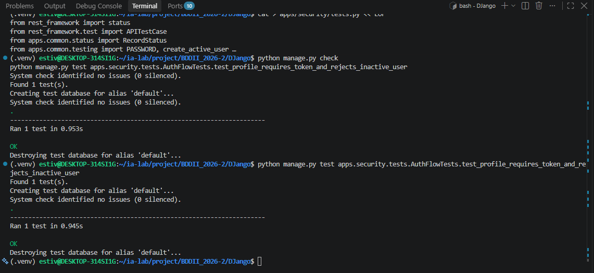
---
## 🛠️ ISS-21 — HasResourceAccess

### 1. Descripción y Objetivos
Implementar la clase de permiso customizada `HasResourceAccess` heredando de `BasePermission` dentro de `apps/security/permissions.py`. Esta clase constituye el motor de autorización fina basado en la matriz RBAC para el nivel de acceso **JWT con token + RBAC**. Evalúa que el usuario esté autenticado y en estado `active`, tratando peticiones `OPTIONS` como permitidas tras autenticación y mapeando solicitudes `HEAD` hacia `GET`. Para cualquier otro verbo HTTP, la clase valida que exista una cadena relacional activa completa entre `user` → `RoleUser` → `Role` → `ResourceRole` → `Resource` comparando el patrón exacto de la ruta registrada (`request.resolver_match.route`). Si alguno de los eslabones relacionales se encuentra inactivo o inexistente, la consulta `.exists()` retorna `False`, aplicando el principio de **negación por defecto** (rejection por defecto) y retornando una respuesta `403 Forbidden` (`401 Unauthorized` si el usuario no tiene credenciales de identidad).

### 2. Comandos Ejecutados
```bash
# 1. Crear apps/security/permissions.py con la clase HasResourceAccess
cat > apps/security/permissions.py <<'EOF'
from rest_framework.permissions import BasePermission
from apps.common.status import RecordStatus
from apps.security.models import ResourceRole

class HasResourceAccess(BasePermission):
    message = "No tiene autorización para ejecutar esta operación."

    def has_permission(self, request, view):
        user = request.user
        if not user or not user.is_authenticated:
            return False
        if getattr(user, "status", None) != RecordStatus.ACTIVE:
            return False
        if request.method.upper() == "OPTIONS":
            return True
        match = request.resolver_match
        if match is None:
            return False
        method = request.method.upper()
        if method == "HEAD":
            method = "GET"
        return ResourceRole.objects.filter(
            status=RecordStatus.ACTIVE,
            resource__status=RecordStatus.ACTIVE,
            resource__method=method,
            resource__route=match.route,
            role__status=RecordStatus.ACTIVE,
            role__assignments__user=user,
            role__assignments__status=RecordStatus.ACTIVE,
        ).exists()
EOF

# 2. Verificación de consistencia del sistema
python manage.py check
```

### 3. Archivos Creados y Modificados
- **`apps/security/permissions.py`**: Creación de la clase `HasResourceAccess` encargada del filtrado y autorización por matriz RBAC contra `request.resolver_match.route`.

### 4. Evidencias
- **EVI-21-01: Verificación de Consistencia de la Clase de Permisos (PASS)**
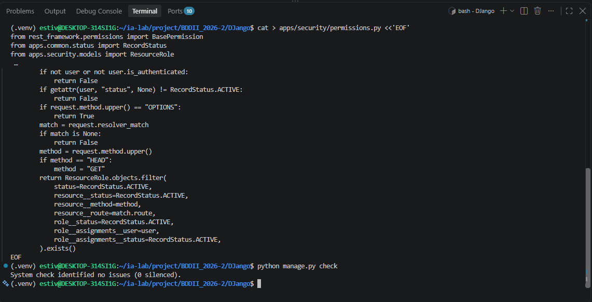
---
## 🛠️ ISS-22 — RBAC sobre el negocio

### 1. Descripción y Objetivos
Migrar la totalidad de las vistas de negocio de la Fase I (`client`, `product` y `sale`) al tercer nivel de seguridad: **JWT con token + RBAC**. Se reemplaza `permission_classes = [AllowAny]` por `permission_classes = [IsAuthenticated, HasResourceAccess]` en todos los viewsets y vistas de APIView (`ClientViewSet`, `ProductTypeViewSet`, `ProductViewSet`, `AvailableProductListAPIView`, `SaleReadViewSet`, `SaleRegisterAPIView` y `SaleCollectionAPIView`). Asimismo, en `config/settings/__init__.py` se actualiza `DEFAULT_PERMISSION_CLASSES` a `IsAuthenticated`. Se actualizan los entornos de pruebas unitarias (`setUp`) incorporando `grant` y `grant_crud` en `apps/common/testing.py` para construir dinámicamente los registros de `Role`, `RoleUser`, `Resource` y `ResourceRole` requeridos antes de invocar `force_authenticate`, certificando el acceso condicionado a la concesión explícita.

### 2. Comandos Ejecutados
```bash
# 1. Definir grant y grant_crud en apps/common/testing.py
cat > apps/common/testing.py <<'EOF'
from django.urls import resolve
from apps.common.status import RecordStatus
from apps.security.models import Resource, ResourceRole, Role, RoleUser, User

PASSWORD = "StoreLab-Test-1"

def create_active_user(username="ana", email="ana@storelab.test", password=PASSWORD):
    return User.objects.create_user(
        username=username,
        email=email,
        password=password,
        status=RecordStatus.ACTIVE,
    )

def grant(user, method, path, role_name=None):
    role, _created = Role.objects.get_or_create(
        name=role_name or f"test-role-{user.pk}",
        defaults={"description": "Rol de prueba", "status": RecordStatus.ACTIVE},
    )
    RoleUser.objects.get_or_create(
        role=role,
        user=user,
        defaults={"status": RecordStatus.ACTIVE},
    )
    match = resolve(path)
    resource, _created = Resource.objects.get_or_create(
        method=method.upper(),
        route=match.route,
        defaults={
            "name": f"{method.upper()} {match.route}",
            "status": RecordStatus.ACTIVE,
        },
    )
    ResourceRole.objects.get_or_create(
        resource=resource,
        role=role,
        defaults={"status": RecordStatus.ACTIVE},
    )
    return role

def grant_crud(user, collection, detail):
    grant(user, "GET", collection)
    grant(user, "POST", collection)
    for method in ("GET", "PUT", "PATCH", "DELETE"):
        grant(user, method, detail)
EOF

# 2. Asignar permission_classes = [IsAuthenticated, HasResourceAccess] en vistas de negocio
cat > apps/client/views.py <<'EOF'
from rest_framework import viewsets
from rest_framework.permissions import IsAuthenticated
from apps.common.status import RecordStatus
from apps.client.models import Client
from apps.client.serializers import ClientSerializer
from apps.security.permissions import HasResourceAccess

class ClientViewSet(viewsets.ModelViewSet):
    queryset = Client.objects.all()
    serializer_class = ClientSerializer
    permission_classes = [IsAuthenticated, HasResourceAccess]
    lookup_value_converter = "int"

    def perform_destroy(self, instance):
        instance.status = RecordStatus.INACTIVE
        instance.save(update_fields=["status", "updated_at"])
EOF

cat > apps/product/views.py <<'EOF'
from rest_framework import viewsets
from rest_framework.generics import ListAPIView
from rest_framework.permissions import IsAuthenticated
from apps.common.status import RecordStatus
from apps.product.models import Product, ProductType
from apps.product.serializers import ProductSerializer, ProductTypeSerializer
from apps.security.permissions import HasResourceAccess

class CatalogViewSet(viewsets.ModelViewSet):
    permission_classes = [IsAuthenticated, HasResourceAccess]
    lookup_value_converter = "int"

    def get_queryset(self):
        queryset = super().get_queryset()
        status_value = self.request.query_params.get("status")
        if status_value:
            queryset = queryset.filter(status=status_value)
        return queryset

    def perform_destroy(self, instance):
        instance.status = RecordStatus.INACTIVE
        instance.save(update_fields=["status", "updated_at"])

class ProductTypeViewSet(CatalogViewSet):
    queryset = ProductType.objects.all()
    serializer_class = ProductTypeSerializer

class ProductViewSet(CatalogViewSet):
    queryset = Product.objects.select_related("product_type")
    serializer_class = ProductSerializer

class AvailableProductListAPIView(ListAPIView):
    permission_classes = [IsAuthenticated, HasResourceAccess]
    serializer_class = ProductSerializer

    def get_queryset(self):
        return Product.objects.select_related("product_type").filter(
            status=RecordStatus.ACTIVE,
            stock__gt=0,
            product_type__status=RecordStatus.ACTIVE,
        )
EOF

cat > apps/sale/views.py <<'EOF'
from rest_framework import mixins, status, viewsets
from rest_framework.permissions import IsAuthenticated
from rest_framework.response import Response
from rest_framework.views import APIView
from drf_spectacular.utils import extend_schema

from apps.common.status import RecordStatus
from apps.sale.models import Sale
from apps.sale.serializers import SaleRegisterSerializer, SaleSerializer
from apps.security.permissions import HasResourceAccess

class SaleReadViewSet(
    mixins.ListModelMixin,
    mixins.RetrieveModelMixin,
    mixins.DestroyModelMixin,
    viewsets.GenericViewSet,
):
    permission_classes = [IsAuthenticated, HasResourceAccess]
    serializer_class = SaleSerializer
    lookup_value_converter = "int"

    def get_queryset(self):
        return Sale.objects.select_related("client").prefetch_related("lines__product")

    def perform_destroy(self, instance):
        instance.void()

class SaleRegisterAPIView(APIView):
    permission_classes = [IsAuthenticated, HasResourceAccess]

    @extend_schema(
        request=SaleRegisterSerializer,
        responses={201: SaleSerializer},
    )
    def post(self, request):
        serializer = SaleRegisterSerializer(data=request.data)
        serializer.is_valid(raise_exception=True)
        sale = serializer.save()
        sale = Sale.objects.prefetch_related("lines__product").get(pk=sale.pk)
        return Response(SaleSerializer(sale).data, status=status.HTTP_201_CREATED)

class SaleCollectionAPIView(APIView):
    permission_classes = [IsAuthenticated, HasResourceAccess]

    @extend_schema(
        responses={200: SaleSerializer(many=True)},
        operation_id="sales_list",
    )
    def get(self, request, *args, **kwargs):
        return SaleReadViewSet.as_view({"get": "list"})(request._request, *args, **kwargs)

    @extend_schema(
        request=SaleRegisterSerializer,
        responses={201: SaleSerializer},
        operation_id="sales_create",
    )
    def post(self, request, *args, **kwargs):
        handler = SaleRegisterAPIView()
        handler.request = request
        handler.format_kwarg = None
        handler.args = ()
        handler.kwargs = {}
        return handler.post(request)
EOF

# 3. Establecer IsAuthenticated como permiso predeterminado en config/settings/__init__.py
python -c '
from pathlib import Path

path = Path("config/settings/__init__.py")
content = path.read_text()

if "rest_framework.permissions.AllowAny" in content:
    content = content.replace(
        "\"rest_framework.permissions.AllowAny\",",
        "\"rest_framework.permissions.IsAuthenticated\","
    )
    path.write_text(content)
    print("Permiso global en settings actualizado a IsAuthenticated.")
'

# 4. Actualizar suites de prueba con create_active_user y grant/grant_crud
cat > apps/client/tests.py <<'EOF'
from rest_framework.test import APITestCase
from apps.client.models import Client
from apps.common.status import RecordStatus
from apps.common.testing import create_active_user, grant_crud

class ClientApiTests(APITestCase):
    def setUp(self):
        self.user = create_active_user()
        grant_crud(self.user, "/api/clients/", "/api/clients/1/")
        self.client.force_authenticate(user=self.user)

    def test_client_crud_and_soft_delete(self):
        created = self.client.post(
            "/api/clients/",
            {
                "name": "Supermercado Central",
                "email": "contacto@central.test",
                "phone": "555-1234",
                "address": "Calle Principal 123",
            },
            format="json",
        )
        self.assertEqual(created.status_code, 201)
        self.assertEqual(created.data["status"], RecordStatus.INACTIVE)
        pk = created.data["id"]

        listed = self.client.get("/api/clients/")
        self.assertEqual(listed.status_code, 200)

        detail = self.client.get(f"/api/clients/{pk}/")
        self.assertEqual(detail.status_code, 200)
        self.assertEqual(detail.data["name"], "Supermercado Central")

        updated = self.client.patch(
            f"/api/clients/{pk}/",
            {"status": "active"},
            format="json",
        )
        self.assertEqual(updated.status_code, 200)
        self.assertEqual(updated.data["status"], RecordStatus.ACTIVE)

        deleted = self.client.delete(f"/api/clients/{pk}/")
        self.assertEqual(deleted.status_code, 204)
        self.assertEqual(Client.objects.get(pk=pk).status, RecordStatus.INACTIVE)
EOF

cat > apps/product/tests.py <<'EOF'
from decimal import Decimal
from django.db.models.deletion import RestrictedError
from rest_framework.test import APITestCase
from apps.common.status import RecordStatus
from apps.common.testing import create_active_user, grant, grant_crud
from apps.product.models import Product, ProductType

class ProductApiTests(APITestCase):
    def setUp(self):
        self.user = create_active_user(username="nora", email="nora@storelab.test")
        grant_crud(self.user, "/api/product-types/", "/api/product-types/1/")
        grant_crud(self.user, "/api/products/", "/api/products/1/")
        grant(self.user, "GET", "/api/products/available/")
        self.client.force_authenticate(user=self.user)
        self.product_type = ProductType.objects.create(name="Bebida", status=RecordStatus.ACTIVE)

    def test_product_type_crud(self):
        created = self.client.post(
            "/api/product-types/",
            {"name": "Lácteo", "description": "Fríos"},
            format="json",
        )
        self.assertEqual(created.status_code, 201)
        self.assertEqual(created.data["status"], RecordStatus.INACTIVE)
        pk = created.data["id"]
        self.assertEqual(self.client.get("/api/product-types/").status_code, 200)
        detail = self.client.get(f"/api/product-types/{pk}/")
        self.assertEqual(detail.data["name"], "Lácteo")
        updated = self.client.patch(
            f"/api/product-types/{pk}/",
            {"status": "active"},
            format="json",
        )
        self.assertEqual(updated.status_code, 200)
        deleted = self.client.delete(f"/api/product-types/{pk}/")
        self.assertEqual(deleted.status_code, 204)
        self.assertEqual(ProductType.objects.get(pk=pk).status, RecordStatus.INACTIVE)

    def test_product_retrieve_update_and_soft_delete(self):
        created = self.client.post(
            "/api/products/",
            {
                "productTypeId": self.product_type.id,
                "name": "Leche",
                "price": "3.20",
                "stock": 2,
                "status": "active",
            },
            format="json",
        )
        pk = created.data["id"]
        detail = self.client.get(f"/api/products/{pk}/")
        self.assertEqual(detail.status_code, 200)
        updated = self.client.patch(f"/api/products/{pk}/", {"stock": 9}, format="json")
        self.assertEqual(updated.status_code, 200)
        self.assertEqual(updated.data["stock"], 9)
        deleted = self.client.delete(f"/api/products/{pk}/")
        self.assertEqual(deleted.status_code, 204)
        self.assertEqual(Product.objects.get(pk=pk).status, RecordStatus.INACTIVE)

    def test_default_status_and_type_restriction(self):
        created = self.client.post(
            "/api/products/",
            {"productTypeId": self.product_type.id, "name": "Té", "price": "1.00"},
            format="json",
        )
        self.assertEqual(created.status_code, 201)
        self.assertEqual(created.data["status"], "inactive")
        self.assertEqual(created.data["stock"], 0)
        with self.assertRaises(RestrictedError):
            self.product_type.delete()

    def test_duplicate_product_name(self):
        payload = {"productTypeId": self.product_type.id, "name": "Café", "price": "3.00"}
        self.assertEqual(self.client.post("/api/products/", payload, format="json").status_code, 201)
        self.assertEqual(self.client.post("/api/products/", payload, format="json").status_code, 400)
        self.assertEqual(Product.objects.get(name="Café").price, Decimal("3.00"))

    def test_product_crud_and_available_filter(self):
        created = self.client.post(
            "/api/products/",
            {
                "productTypeId": self.product_type.id,
                "name": "Agua",
                "price": "2.50",
                "stock": 4,
                "status": "active",
            },
            format="json",
        )
        self.assertEqual(created.status_code, 201)
        available = self.client.get("/api/products/available/")
        self.assertEqual(available.status_code, 200)
        self.assertEqual(len(available.data), 1)
        Product.objects.filter(pk=created.data["id"]).update(stock=0)
        empty = self.client.get("/api/products/available/")
        self.assertEqual(empty.data, [])
EOF

cat > apps/sale/tests.py <<'EOF'
from decimal import Decimal
from unittest.mock import patch
from django.utils import timezone
from rest_framework.test import APITestCase
from apps.client.models import Client
from apps.common.status import RecordStatus
from apps.common.testing import create_active_user, grant
from apps.product.models import Product, ProductType
from apps.sale.models import ProductSale, Sale

class SaleTransactionTests(APITestCase):
    def setUp(self):
        self.user = create_active_user(username="leo", email="leo@storelab.test")
        grant(self.user, "GET", "/api/sales/")
        grant(self.user, "POST", "/api/sales/")
        grant(self.user, "GET", "/api/sales/1/")
        grant(self.user, "DELETE", "/api/sales/1/")
        self.client.force_authenticate(user=self.user)
        self.buyer = Client.objects.create(name="Comprador", status=RecordStatus.ACTIVE)
        product_type = ProductType.objects.create(name="Abarrote", status=RecordStatus.ACTIVE)
        self.water = Product.objects.create(
            product_type=product_type,
            name="Agua",
            price=Decimal("10.00"),
            stock=5,
            status=RecordStatus.ACTIVE,
        )
        self.bread = Product.objects.create(
            product_type=product_type,
            name="Pan",
            price=Decimal("4.50"),
            stock=2,
            status=RecordStatus.ACTIVE,
        )

    def _payload(self, items, discounts="0.00"):
        return {
            "clientId": self.buyer.id,
            "saleDate": timezone.now().isoformat(),
            "discounts": discounts,
            "items": items,
        }

    def test_register_snapshots_price_and_discounts_stock(self):
        response = self.client.post(
            "/api/sales/",
            self._payload(
                [
                    {"productId": self.water.id, "quantity": 2},
                    {"productId": self.bread.id, "quantity": 1},
                ],
                discounts="1.50",
            ),
            format="json",
        )
        self.assertEqual(response.status_code, 201, response.data)
        self.assertEqual(response.data["tax"], "0.00")
        self.assertEqual(response.data["subtotal"], "24.50")
        self.assertEqual(response.data["total"], "23.00")
        self.assertEqual(response.data["status"], "active")
        water_line = next(
            line for line in response.data["lines"] if line["product"] == self.water.id
        )
        self.assertEqual(water_line["unit_price"], "10.00")
        self.water.refresh_from_db()
        self.bread.refresh_from_db()
        self.assertEqual(self.water.stock, 3)
        self.assertEqual(self.bread.stock, 1)

    def test_insufficient_stock_rolls_back(self):
        response = self.client.post(
            "/api/sales/",
            self._payload([{"productId": self.bread.id, "quantity": 3}]),
            format="json",
        )
        self.assertEqual(response.status_code, 400)
        self.assertEqual(Sale.objects.count(), 0)
        self.bread.refresh_from_db()
        self.assertEqual(self.bread.stock, 2)

    def test_stock_failure_rolls_back_the_sale(self):
        original = Product.save
        def fail_stock(product, *args, **kwargs):
            update_fields = kwargs.get("update_fields")
            if update_fields and "stock" in update_fields:
                raise RuntimeError("fallo de stock")
            return original(product, *args, **kwargs)

        with patch.object(Product, "save", fail_stock):
            with self.assertRaises(RuntimeError):
                self.client.post(
                    "/api/sales/",
                    self._payload([{"productId": self.water.id, "quantity": 1}]),
                    format="json",
                )
        self.assertEqual(Sale.objects.count(), 0)
        self.assertEqual(ProductSale.objects.count(), 0)

    def test_inactive_client_is_rejected(self):
        self.buyer.status = RecordStatus.INACTIVE
        self.buyer.save()
        response = self.client.post(
            "/api/sales/",
            self._payload([{"productId": self.water.id, "quantity": 1}]),
            format="json",
        )
        self.assertEqual(response.status_code, 400)
        self.assertEqual(Sale.objects.count(), 0)

    def test_detail_keeps_historical_price(self):
        response = self.client.post(
            "/api/sales/",
            self._payload([{"productId": self.water.id, "quantity": 1}]),
            format="json",
        )
        Product.objects.filter(pk=self.water.pk).update(price=Decimal("99.00"))
        detail = self.client.get(f"/api/sales/{response.data['id']}/")
        self.assertEqual(detail.status_code, 200)
        self.assertEqual(detail.data["lines"][0]["unit_price"], "10.00")

    def test_list_returns_the_registered_sale(self):
        created = self.client.post(
            "/api/sales/",
            self._payload([{"productId": self.water.id, "quantity": 1}]),
            format="json",
        )
        listed = self.client.get("/api/sales/")
        self.assertEqual(listed.status_code, 200)
        self.assertTrue(any(row["id"] == created.data["id"] for row in listed.data))

    def test_void_restores_stock_once(self):
        created = self.client.post(
            "/api/sales/",
            self._payload([{"productId": self.water.id, "quantity": 2}]),
            format="json",
        )
        sale_id = created.data["id"]
        first = self.client.delete(f"/api/sales/{sale_id}/")
        second = self.client.delete(f"/api/sales/{sale_id}/")
        self.assertEqual(first.status_code, 204)
        self.assertEqual(second.status_code, 204)
        self.water.refresh_from_db()
        self.assertEqual(self.water.stock, 5)
        sale = Sale.objects.get(pk=sale_id)
        self.assertEqual(sale.status, RecordStatus.INACTIVE)
EOF

# 5. Ejecutar chequeo y suite de pruebas de negocio con RBAC
python manage.py check
python manage.py test apps.client apps.product apps.sale
```

### 3. Archivos Creados y Modificados
- **`apps/common/testing.py`**: Adición de las funciones helper `grant()` y `grant_crud()`.
- **`apps/client/views.py`**, **`apps/product/views.py`**, **`apps/sale/views.py`**: Reemplazo de `AllowAny` por `[IsAuthenticated, HasResourceAccess]`.
- **`config/settings/__init__.py`**: Cambio de `DEFAULT_PERMISSION_CLASSES` a `IsAuthenticated`.
- **`apps/client/tests.py`**, **`apps/product/tests.py`**, **`apps/sale/tests.py`**: Actualización de `setUp` con creación de usuario activo, concesión explícita y autenticación forzada.

### 4. Evidencias
- **EVI-22-01: Verificación de Pruebas de Negocio bajo el Nivel de Seguridad JWT + RBAC (PASS)**
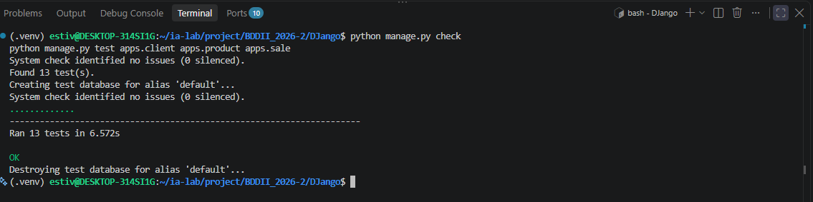
---
## 🛠️ ISS-23 — CRUD de la matriz

### 1. Descripción y Objetivos
Publicar los endpoints de administración de la matriz RBAC para la gestión dinámica de usuarios (`/api/users/`), roles (`/api/roles/`), asignación usuario-rol (`/api/role-users/`), catálogo de recursos (`/api/resources/`) y permisos recurso-rol (`/api/resource-roles/`). Todos los endpoints derivan de la clase base `SoftDeleteModelViewSet`, aplicando baja lógica (`status='inactive'`) en `perform_destroy` y filtrado `?status=`. Se configura `UserSerializer` declarando `password` como campo de solo escritura (`write_only=True`), aplicando las validaciones estándar de contraseñas de Django y procesándolas mediante `set_password()`. El acceso a cada vista requiere autorización de nivel **JWT con token + RBAC** (`[IsAuthenticated, HasResourceAccess]`).

### 2. Comandos Ejecutados
```bash
# 1. Definir serializadores de la matriz en apps/security/serializers.py
cat > apps/security/serializers.py <<'EOF'
from django.contrib.auth import get_user_model
from rest_framework import serializers
from apps.security.models import Resource, ResourceRole, Role, RoleUser

User = get_user_model()

class ProfileSerializer(serializers.ModelSerializer):
    class Meta:
        model = User
        fields = [
            "id",
            "username",
            "email",
            "first_name",
            "last_name",
            "status",
        ]
        read_only_fields = ["id", "username", "status"]

class LoginSerializer(serializers.Serializer):
    username = serializers.CharField(required=False, allow_blank=False)
    email = serializers.EmailField(required=False)
    password = serializers.CharField(write_only=True)

    def validate(self, attrs):
        if not attrs.get("username") and not attrs.get("email"):
            raise serializers.ValidationError(
                "Informe username o email junto con password."
            )
        return attrs

class RefreshSerializer(serializers.Serializer):
    refresh = serializers.CharField()

class LogoutSerializer(serializers.Serializer):
    refresh = serializers.CharField()

class TokenPairSerializer(serializers.Serializer):
    access = serializers.CharField()
    refresh = serializers.CharField()
    token_type = serializers.CharField()
    access_expires_in = serializers.IntegerField()

class UserSerializer(serializers.ModelSerializer):
    password = serializers.CharField(write_only=True, required=False, allow_blank=False)

    class Meta:
        model = User
        fields = [
            "id",
            "username",
            "email",
            "first_name",
            "last_name",
            "status",
            "password",
            "created_at",
            "updated_at",
        ]
        read_only_fields = ["id", "created_at", "updated_at"]

    def validate_password(self, value):
        from django.contrib.auth.password_validation import validate_password
        from django.core.exceptions import ValidationError as DjangoValidationError
        try:
            validate_password(value)
        except DjangoValidationError as exc:
            raise serializers.ValidationError(list(exc.messages)) from exc
        return value

    def create(self, validated_data):
        password = validated_data.pop("password", None)
        user = super().create(validated_data)
        if password:
            user.set_password(password)
            user.save()
        return user

    def update(self, instance, validated_data):
        password = validated_data.pop("password", None)
        user = super().update(instance, validated_data)
        if password:
            user.set_password(password)
            user.save()
        return user

class RoleSerializer(serializers.ModelSerializer):
    class Meta:
        model = Role
        fields = [
            "id",
            "name",
            "description",
            "status",
            "created_at",
            "updated_at",
        ]
        read_only_fields = ["id", "created_at", "updated_at"]

class RoleUserSerializer(serializers.ModelSerializer):
    class Meta:
        model = RoleUser
        fields = [
            "id",
            "role",
            "user",
            "status",
            "created_at",
            "updated_at",
        ]
        read_only_fields = ["id", "created_at", "updated_at"]

class ResourceSerializer(serializers.ModelSerializer):
    class Meta:
        model = Resource
        fields = [
            "id",
            "name",
            "method",
            "route",
            "status",
            "created_at",
            "updated_at",
        ]
        read_only_fields = ["id", "created_at", "updated_at"]

class ResourceRoleSerializer(serializers.ModelSerializer):
    class Meta:
        model = ResourceRole
        fields = [
            "id",
            "resource",
            "role",
            "status",
            "created_at",
            "updated_at",
        ]
        read_only_fields = ["id", "created_at", "updated_at"]
EOF

# 2. Definir SoftDeleteModelViewSet y viewsets de la matriz en apps/security/rbac_views.py
cat > apps/security/rbac_views.py <<'EOF'
from rest_framework import viewsets
from rest_framework.generics import RetrieveUpdateAPIView
from rest_framework.permissions import IsAuthenticated
from apps.common.status import RecordStatus
from apps.security.models import Resource, ResourceRole, Role, RoleUser, User
from apps.security.permissions import HasResourceAccess
from apps.security.serializers import (
    ProfileSerializer,
    ResourceRoleSerializer,
    ResourceSerializer,
    RoleSerializer,
    RoleUserSerializer,
    UserSerializer,
)

class ProfileAPIView(RetrieveUpdateAPIView):
    serializer_class = ProfileSerializer
    permission_classes = [IsAuthenticated]
    http_method_names = ["get", "patch", "head", "options"]

    def get_object(self):
        return self.request.user

class SoftDeleteModelViewSet(viewsets.ModelViewSet):
    permission_classes = [IsAuthenticated, HasResourceAccess]
    lookup_value_converter = "int"

    def get_queryset(self):
        queryset = super().get_queryset()
        status_value = self.request.query_params.get("status")
        if status_value:
            queryset = queryset.filter(status=status_value)
        return queryset

    def perform_destroy(self, instance):
        instance.status = RecordStatus.INACTIVE
        instance.save(update_fields=["status", "updated_at"])

class UserViewSet(SoftDeleteModelViewSet):
    queryset = User.objects.all()
    serializer_class = UserSerializer

class RoleViewSet(SoftDeleteModelViewSet):
    queryset = Role.objects.all()
    serializer_class = RoleSerializer

class RoleUserViewSet(SoftDeleteModelViewSet):
    queryset = RoleUser.objects.select_related("role", "user")
    serializer_class = RoleUserSerializer

class ResourceViewSet(SoftDeleteModelViewSet):
    queryset = Resource.objects.all()
    serializer_class = ResourceSerializer

class ResourceRoleViewSet(SoftDeleteModelViewSet):
    queryset = ResourceRole.objects.select_related("resource", "role")
    serializer_class = ResourceRoleSerializer
EOF

# 3. Registrar viewsets en apps/security/urls.py mediante SimpleRouter
cat > apps/security/urls.py <<'EOF'
from django.urls import path
from rest_framework.routers import SimpleRouter
from apps.security.auth_views import LoginAPIView, LogoutAPIView, RefreshAPIView
from apps.security.rbac_views import (
    ProfileAPIView,
    ResourceRoleViewSet,
    ResourceViewSet,
    RoleUserViewSet,
    RoleViewSet,
    UserViewSet,
)

urlpatterns = [
    path("auth/login/", LoginAPIView.as_view(), name="auth-login"),
    path("auth/refresh/", RefreshAPIView.as_view(), name="auth-refresh"),
    path("auth/logout/", LogoutAPIView.as_view(), name="auth-logout"),
    path("auth/profile/", ProfileAPIView.as_view(), name="auth-profile"),
]

router = SimpleRouter(use_regex_path=False)
router.register("users", UserViewSet, basename="user")
router.register("roles", RoleViewSet, basename="role")
router.register("role-users", RoleUserViewSet, basename="role-user")
router.register("resources", ResourceViewSet, basename="resource")
router.register("resource-roles", ResourceRoleViewSet, basename="resource-role")

urlpatterns += router.urls
EOF

# 4. Definir suite de pruebas SecurityMatrixApiTests en apps/security/tests.py
cat > apps/security/tests.py <<'EOF'
from django.urls import resolve
from rest_framework import status
from rest_framework.test import APITestCase
from apps.common.status import RecordStatus
from apps.common.testing import PASSWORD, create_active_user, grant_crud
from apps.security.models import RefreshToken, Role, User
from apps.security.tokens import hash_token

class AuthFlowTests(APITestCase):
    def setUp(self):
        self.user = create_active_user()

    def test_login_with_username_and_email(self):
        by_username = self.client.post(
            "/api/auth/login/",
            {"username": "ana", "password": PASSWORD},
            format="json",
        )
        self.assertEqual(by_username.status_code, status.HTTP_200_OK)
        self.assertIn("access", by_username.data)
        self.assertIn("refresh", by_username.data)
        self.assertNotIn("password", by_username.data)
        stored = RefreshToken.objects.get()
        self.assertEqual(stored.token_hash, hash_token(by_username.data["refresh"]))
        by_email = self.client.post(
            "/api/auth/login/",
            {"email": "ANA@storelab.test", "password": PASSWORD},
            format="json",
        )
        self.assertEqual(by_email.status_code, status.HTTP_200_OK)

    def test_inactive_user_and_bad_password_are_401(self):
        self.user.status = RecordStatus.INACTIVE
        self.user.save()
        inactive = self.client.post(
            "/api/auth/login/",
            {"username": "ana", "password": PASSWORD},
            format="json",
        )
        self.assertEqual(inactive.status_code, status.HTTP_401_UNAUTHORIZED)

    def test_refresh_rotates_and_reuse_revokes_family(self):
        login = self.client.post(
            "/api/auth/login/",
            {"username": "ana", "password": PASSWORD},
            format="json",
        )
        first = login.data["refresh"]
        rotated = self.client.post("/api/auth/refresh/", {"refresh": first}, format="json")
        self.assertEqual(rotated.status_code, status.HTTP_200_OK)
        second = rotated.data["refresh"]
        self.assertNotEqual(first, second)
        reused = self.client.post("/api/auth/refresh/", {"refresh": first}, format="json")
        self.assertEqual(reused.status_code, status.HTTP_401_UNAUTHORIZED)
        after_reuse = self.client.post("/api/auth/refresh/", {"refresh": second}, format="json")
        self.assertEqual(after_reuse.status_code, status.HTTP_401_UNAUTHORIZED)

    def test_logout_invalidates_refresh(self):
        login = self.client.post(
            "/api/auth/login/",
            {"username": "ana", "password": PASSWORD},
            format="json",
        )
        raw = login.data["refresh"]
        logout = self.client.post("/api/auth/logout/", {"refresh": raw}, format="json")
        self.assertEqual(logout.status_code, status.HTTP_204_NO_CONTENT)
        again = self.client.post("/api/auth/refresh/", {"refresh": raw}, format="json")
        self.assertEqual(again.status_code, status.HTTP_401_UNAUTHORIZED)

    def test_profile_requires_token_and_rejects_inactive_user(self):
        anonymous = self.client.get("/api/auth/profile/")
        self.assertEqual(anonymous.status_code, status.HTTP_401_UNAUTHORIZED)
        login = self.client.post(
            "/api/auth/login/",
            {"username": "ana", "password": PASSWORD},
            format="json",
        )
        self.client.credentials(HTTP_AUTHORIZATION=f"Bearer {login.data['access']}")
        profile = self.client.get("/api/auth/profile/")
        self.assertEqual(profile.status_code, status.HTTP_200_OK)
        self.assertEqual(profile.data["username"], "ana")
        patched = self.client.patch(
            "/api/auth/profile/",
            {"firstName": "Ana"},
            format="json",
        )
        self.assertEqual(patched.status_code, status.HTTP_200_OK)
        self.user.status = RecordStatus.INACTIVE
        self.user.save()
        denied = self.client.get("/api/auth/profile/")
        self.assertEqual(denied.status_code, status.HTTP_401_UNAUTHORIZED)

class SecurityMatrixApiTests(APITestCase):
    def setUp(self):
        self.user = create_active_user(username="admin_rbac", email="admin@storelab.test")
        grant_crud(self.user, "/api/users/", "/api/users/1/")
        grant_crud(self.user, "/api/roles/", "/api/roles/1/")
        grant_crud(self.user, "/api/role-users/", "/api/role-users/1/")
        grant_crud(self.user, "/api/resources/", "/api/resources/1/")
        grant_crud(self.user, "/api/resource-roles/", "/api/resource-roles/1/")
        self.client.force_authenticate(user=self.user)

    def test_role_crud(self):
        created = self.client.post(
            "/api/roles/",
            {"name": "bodega", "description": "Rol Bodega", "status": "active"},
            format="json",
        )
        self.assertEqual(created.status_code, status.HTTP_201_CREATED)
        pk = created.data["id"]

        listed = self.client.get("/api/roles/")
        self.assertEqual(listed.status_code, status.HTTP_200_OK)

        detail = self.client.get(f"/api/roles/{pk}/")
        self.assertEqual(detail.status_code, status.HTTP_200_OK)
        self.assertEqual(detail.data["name"], "bodega")

        updated = self.client.patch(
            f"/api/roles/{pk}/",
            {"description": "Rol de Bodega e Inventario"},
            format="json",
        )
        self.assertEqual(updated.status_code, status.HTTP_200_OK)
        self.assertEqual(updated.data["description"], "Rol de Bodega e Inventario")

        deleted = self.client.delete(f"/api/roles/{pk}/")
        self.assertEqual(deleted.status_code, status.HTTP_204_NO_CONTENT)
        self.assertEqual(Role.objects.get(pk=pk).status, RecordStatus.INACTIVE)

    def test_user_role_resource_chain(self):
        role_res = self.client.post(
            "/api/roles/",
            {"name": "bodega", "status": "active"},
            format="json",
        )
        self.assertEqual(role_res.status_code, status.HTTP_201_CREATED)
        role_id = role_res.data["id"]

        user_res = self.client.post(
            "/api/users/",
            {
                "username": "bodega1",
                "email": "bodega1@storelab.test",
                "password": PASSWORD,
                "status": "active",
            },
            format="json",
        )
        self.assertEqual(user_res.status_code, status.HTTP_201_CREATED)
        self.assertNotIn("password", user_res.data)
        new_user_id = user_res.data["id"]
        new_user = User.objects.get(pk=new_user_id)

        self.client.force_authenticate(user=new_user)
        self.assertEqual(self.client.get("/api/clients/").status_code, status.HTTP_403_FORBIDDEN)

        self.client.force_authenticate(user=self.user)

        ru_res = self.client.post(
            "/api/role-users/",
            {"role": role_id, "user": new_user_id, "status": "active"},
            format="json",
        )
        self.assertEqual(ru_res.status_code, status.HTTP_201_CREATED)

        self.client.force_authenticate(user=new_user)
        self.assertEqual(self.client.get("/api/clients/").status_code, status.HTTP_403_FORBIDDEN)

        self.client.force_authenticate(user=self.user)

        match = resolve("/api/clients/")
        res_res = self.client.post(
            "/api/resources/",
            {"name": "GET Clients", "method": "GET", "route": match.route, "status": "active"},
            format="json",
        )
        self.assertEqual(res_res.status_code, status.HTTP_201_CREATED)
        resource_id = res_res.data["id"]

        self.client.force_authenticate(user=new_user)
        self.assertEqual(self.client.get("/api/clients/").status_code, status.HTTP_403_FORBIDDEN)

        self.client.force_authenticate(user=self.user)

        rr_res = self.client.post(
            "/api/resource-roles/",
            {"resource": resource_id, "role": role_id, "status": "active"},
            format="json",
        )
        self.assertEqual(rr_res.status_code, status.HTTP_201_CREATED)

        self.client.force_authenticate(user=new_user)
        self.assertEqual(self.client.get("/api/clients/").status_code, status.HTTP_200_OK)
        self.assertEqual(
            self.client.post(
                "/api/clients/",
                {"name": "Cliente X", "email": "x@test.com"},
                format="json",
            ).status_code,
            status.HTTP_403_FORBIDDEN,
        )
EOF

# 5. Ejecutar chequeo y pruebas de la matriz RBAC
python manage.py check
python manage.py test apps.security.tests.SecurityMatrixApiTests
```

### 3. Archivos Creados y Modificados
- **`apps/security/serializers.py`**: Adición de `UserSerializer`, `RoleSerializer`, `RoleUserSerializer`, `ResourceSerializer` y `ResourceRoleSerializer`.
- **`apps/security/rbac_views.py`**: Definición de `SoftDeleteModelViewSet` y de las vistas `UserViewSet`, `RoleViewSet`, `RoleUserViewSet`, `ResourceViewSet` y `ResourceRoleViewSet`.
- **`apps/security/urls.py`**: Registro de las 10 rutas CRUD de la matriz RBAC utilizando `SimpleRouter`.
- **`apps/security/tests.py`**: Adición de `SecurityMatrixApiTests` para validar las operaciones CRUD de los componentes de seguridad y la cadena completa de autorización relacional por eslabones.

### 4. Evidencias
- **EVI-23-01: Verificación de Operaciones CRUD y Autorización Dinámica por Cadena RBAC (PASS)**
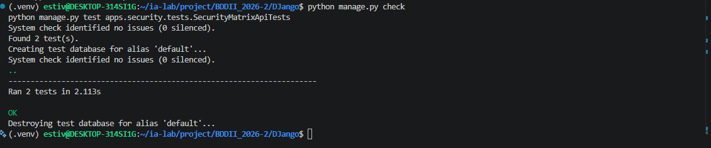
 demostrando la validez del CRUD de la matriz, la no exposición ni almacenamiento en claro de contraseñas, la baja lógica en eliminación, y el correcto funcionamiento progresivo del control de acceso en cada eslabón relacional.
---
## 🛠️ ISS-24 — Semilla RBAC y Swagger con Bearer

### 1. Descripción y Objetivos
Implementar el comando personalizado de Django `python manage.py seed_rbac` para la sincronización automática de las rutas de negocio y seguridad en la tabla `resources`. El comando realiza la resolución dinámica de URL mediante `resolve(path).route`, asegurando que los patrones de rutas dinámicas se almacenen con los delimitadores estándar de Django (`api/clients/<int:pk>/`). Adicionalmente, crea el rol de sistema `admin` asociando todos los recursos a través de `ResourceRole` en estado `active`, y admite el argumento `--username` para vincular automáticamente a un usuario mediante `RoleUser`. Para la interfaz interactiva de Swagger UI, se define la extensión `StoreLabJWTScheme` en `apps/security/schema.py` (heredando de `OpenApiAuthenticationExtension`) e importada en el método `ready()` de `SecurityConfig`, registrando el esquema de seguridad Bearer JWT (`bearerAuth`) y habilitando el botón **Authorize**.

### 2. Comandos Ejecutados
```bash
# 1. Definir extensión OpenAPI para Swagger UI en apps/security/schema.py
cat > apps/security/schema.py <<'EOF'
from drf_spectacular.extensions import OpenApiAuthenticationExtension

class StoreLabJWTScheme(OpenApiAuthenticationExtension):
    target_class = "apps.security.authentication.StoreLabJWTAuthentication"
    name = "bearerAuth"

    def get_security_definition(self, auto_schema):
        return {"type": "http", "scheme": "bearer", "bearerFormat": "JWT"}
EOF

# 2. Registrar la extensión en apps/security/apps.py
cat > apps/security/apps.py <<'EOF'
from django.apps import AppConfig

class SecurityConfig(AppConfig):
    default_auto_field = "django.db.models.BigAutoField"
    name = "apps.security"
    label = "security"

    def ready(self):
        from apps.security import schema  # noqa: F401
EOF

# 3. Crear el comando de gestión personalizado seed_rbac.py
mkdir -p apps/security/management/commands
touch apps/security/management/__init__.py
touch apps/security/management/commands/__init__.py

cat > apps/security/management/commands/seed_rbac.py <<'EOF'
from django.core.management.base import BaseCommand
from django.urls import resolve
from apps.common.status import RecordStatus
from apps.security.models import Resource, ResourceRole, Role, RoleUser, User

class Command(BaseCommand):
    help = "Sincroniza las rutas del sistema en la matriz RBAC y concede permisos al rol admin."

    def add_arguments(self, parser):
        parser.add_argument(
            "--username",
            type=str,
            help="Asigna el rol admin a un usuario existente.",
        )

    def handle(self, *args, **options):
        sample_endpoints = [
            # Clients
            ("GET", "/api/clients/"),
            ("POST", "/api/clients/"),
            ("GET", "/api/clients/1/"),
            ("PUT", "/api/clients/1/"),
            ("PATCH", "/api/clients/1/"),
            ("DELETE", "/api/clients/1/"),
            # Product Types
            ("GET", "/api/product-types/"),
            ("POST", "/api/product-types/"),
            ("GET", "/api/product-types/1/"),
            ("PUT", "/api/product-types/1/"),
            ("PATCH", "/api/product-types/1/"),
            ("DELETE", "/api/product-types/1/"),
            # Products
            ("GET", "/api/products/"),
            ("POST", "/api/products/"),
            ("GET", "/api/products/1/"),
            ("PUT", "/api/products/1/"),
            ("PATCH", "/api/products/1/"),
            ("DELETE", "/api/products/1/"),
            ("GET", "/api/products/available/"),
            # Sales
            ("GET", "/api/sales/"),
            ("POST", "/api/sales/"),
            ("GET", "/api/sales/1/"),
            ("DELETE", "/api/sales/1/"),
            # Users
            ("GET", "/api/users/"),
            ("POST", "/api/users/"),
            ("GET", "/api/users/1/"),
            ("PUT", "/api/users/1/"),
            ("PATCH", "/api/users/1/"),
            ("DELETE", "/api/users/1/"),
            # Roles
            ("GET", "/api/roles/"),
            ("POST", "/api/roles/"),
            ("GET", "/api/roles/1/"),
            ("PUT", "/api/roles/1/"),
            ("PATCH", "/api/roles/1/"),
            ("DELETE", "/api/roles/1/"),
            # RoleUsers
            ("GET", "/api/role-users/"),
            ("POST", "/api/role-users/"),
            ("GET", "/api/role-users/1/"),
            ("PUT", "/api/role-users/1/"),
            ("PATCH", "/api/role-users/1/"),
            ("DELETE", "/api/role-users/1/"),
            # Resources
            ("GET", "/api/resources/"),
            ("POST", "/api/resources/"),
            ("GET", "/api/resources/1/"),
            ("PUT", "/api/resources/1/"),
            ("PATCH", "/api/resources/1/"),
            ("DELETE", "/api/resources/1/"),
            # ResourceRoles
            ("GET", "/api/resource-roles/"),
            ("POST", "/api/resource-roles/"),
            ("GET", "/api/resource-roles/1/"),
            ("PUT", "/api/resource-roles/1/"),
            ("PATCH", "/api/resource-roles/1/"),
            ("DELETE", "/api/resource-roles/1/"),
        ]

        admin_role, _ = Role.objects.get_or_create(
            name="admin",
            defaults={"description": "Rol Administrador del Sistema", "status": RecordStatus.ACTIVE},
        )
        if admin_role.status != RecordStatus.ACTIVE:
            admin_role.status = RecordStatus.ACTIVE
            admin_role.save(update_fields=["status", "updated_at"])

        count = 0
        for method, path in sample_endpoints:
            match = resolve(path)
            route_pattern = match.route
            resource, _ = Resource.objects.get_or_create(
                method=method,
                route=route_pattern,
                defaults={
                    "name": f"{method} {route_pattern}",
                    "status": RecordStatus.ACTIVE,
                },
            )
            if resource.status != RecordStatus.ACTIVE:
                resource.status = RecordStatus.ACTIVE
                resource.save(update_fields=["status", "updated_at"])

            rr, _ = ResourceRole.objects.get_or_create(
                resource=resource,
                role=admin_role,
                defaults={"status": RecordStatus.ACTIVE},
            )
            if rr.status != RecordStatus.ACTIVE:
                rr.status = RecordStatus.ACTIVE
                rr.save(update_fields=["status", "updated_at"])
            count += 1

        username = options.get("username")
        if username:
            try:
                user = User.objects.get(username=username)
                ru, _ = RoleUser.objects.get_or_create(
                    role=admin_role,
                    user=user,
                    defaults={"status": RecordStatus.ACTIVE},
                )
                if ru.status != RecordStatus.ACTIVE:
                    ru.status = RecordStatus.ACTIVE
                    ru.save(update_fields=["status", "updated_at"])
                self.stdout.write(self.style.SUCCESS(f"Rol admin asignado al usuario {username}."))
            except User.DoesNotExist:
                self.stdout.write(self.style.ERROR(f"Usuario {username} no encontrado."))

        self.stdout.write(self.style.SUCCESS(f"Recursos RBAC sincronizados. Total procesados: {count}."))
EOF

# 4. Ejecución de la semilla para el usuario administrador
python manage.py seed_rbac --username admin

# 5. Re-validación del esquema de la API con drf-spectacular
python manage.py spectacular --file /tmp/storelab-schema.yml --validate
```

### 3. Archivos Creados y Modificados
- **`apps/security/schema.py`**: Definición de `StoreLabJWTScheme` para registrar `bearerAuth` en OpenAPI.
- **`apps/security/apps.py`**: Adición del hook `ready()` en `SecurityConfig`.
- **`apps/security/management/commands/seed_rbac.py`**: Creación del comando de consola `seed_rbac` para la población de recursos, creación del rol `admin` y vinculación de usuarios.

### 4. Evidencias
- **EVI-24-01: Ejecución Limpia del Comando seed_rbac (PASS)**
  - **Descripción:** Captura de la terminal confirmando la salida exitosa del comando `python manage.py seed_rbac --username admin`, sincronizando las rutas de la API en la base de datos y otorgando concesiones al rol `admin`.
- **EVI-24-02: Verificación de Formato de Rutas en Tabla resources (PASS)**
  - **Descripción:** Confirmación de que las rutas procesadas emplean el patrón de resolución dinámica con parámetros tipados (`api/clients/<int:pk>/`).
- **EVI-24-03: Validación del Esquema OpenAPI con Botón Authorize (PASS)**
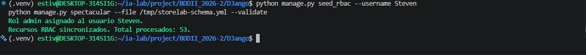
---
## 🛠️ ISS-25 — Pruebas 401 y 403 (Cierre de la Fase II — Auth con RBAC)

### 1. Descripción y Objetivos
Establecer en la suite de pruebas la distinción estricta entre la ausencia de identidad (HTTP 401 Unauthorized) y la falta de autorización o concesión explícita (HTTP 403 Forbidden). Se implementa la clase `RbacTests` en `apps/security/tests.py`. El test `test_missing_grant_is_403_and_missing_identity_is_401` certifica que una petición realizada por un usuario autenticado pero sin concesión asignada retorna `403 Forbidden`, mientras que la misma solicitud realizada de forma anónima (`user=None`) produce `401 Unauthorized`. Adicionalmente, el test `test_any_inactive_link_denies` valida la regla de negación por defecto al conmutar progresivamente a `inactive` cada uno de los eslabones de la cadena RBAC (`Role`, `RoleUser`, `ResourceRole` y `Resource`), verificando que la inactivación de cualquier componente revoca el acceso devolviendo `403 Forbidden`. Con esta unidad se concluye la **Fase II — Auth con RBAC** y la construcción del proyecto **StoreLab**.

### 2. Comandos Ejecutados
```bash
# 1. Definir la suite de pruebas completa en apps/security/tests.py incluyendo RbacTests
cat > apps/security/tests.py <<'EOF'
from django.urls import resolve
from rest_framework import status
from rest_framework.test import APITestCase
from apps.common.status import RecordStatus
from apps.common.testing import PASSWORD, create_active_user, grant, grant_crud
from apps.security.models import RefreshToken, Resource, ResourceRole, Role, RoleUser, User
from apps.security.tokens import hash_token

class AuthFlowTests(APITestCase):
    def setUp(self):
        self.user = create_active_user()

    def test_login_with_username_and_email(self):
        by_username = self.client.post(
            "/api/auth/login/",
            {"username": "ana", "password": PASSWORD},
            format="json",
        )
        self.assertEqual(by_username.status_code, status.HTTP_200_OK)
        self.assertIn("access", by_username.data)
        self.assertIn("refresh", by_username.data)
        self.assertNotIn("password", by_username.data)
        stored = RefreshToken.objects.get()
        self.assertEqual(stored.token_hash, hash_token(by_username.data["refresh"]))
        by_email = self.client.post(
            "/api/auth/login/",
            {"email": "ANA@storelab.test", "password": PASSWORD},
            format="json",
        )
        self.assertEqual(by_email.status_code, status.HTTP_200_OK)

    def test_inactive_user_and_bad_password_are_401(self):
        self.user.status = RecordStatus.INACTIVE
        self.user.save()
        inactive = self.client.post(
            "/api/auth/login/",
            {"username": "ana", "password": PASSWORD},
            format="json",
        )
        self.assertEqual(inactive.status_code, status.HTTP_401_UNAUTHORIZED)

    def test_refresh_rotates_and_reuse_revokes_family(self):
        login = self.client.post(
            "/api/auth/login/",
            {"username": "ana", "password": PASSWORD},
            format="json",
        )
        first = login.data["refresh"]
        rotated = self.client.post("/api/auth/refresh/", {"refresh": first}, format="json")
        self.assertEqual(rotated.status_code, status.HTTP_200_OK)
        second = rotated.data["refresh"]
        self.assertNotEqual(first, second)
        reused = self.client.post("/api/auth/refresh/", {"refresh": first}, format="json")
        self.assertEqual(reused.status_code, status.HTTP_401_UNAUTHORIZED)
        after_reuse = self.client.post("/api/auth/refresh/", {"refresh": second}, format="json")
        self.assertEqual(after_reuse.status_code, status.HTTP_401_UNAUTHORIZED)

    def test_logout_invalidates_refresh(self):
        login = self.client.post(
            "/api/auth/login/",
            {"username": "ana", "password": PASSWORD},
            format="json",
        )
        raw = login.data["refresh"]
        logout = self.client.post("/api/auth/logout/", {"refresh": raw}, format="json")
        self.assertEqual(logout.status_code, status.HTTP_204_NO_CONTENT)
        again = self.client.post("/api/auth/refresh/", {"refresh": raw}, format="json")
        self.assertEqual(again.status_code, status.HTTP_401_UNAUTHORIZED)

    def test_profile_requires_token_and_rejects_inactive_user(self):
        anonymous = self.client.get("/api/auth/profile/")
        self.assertEqual(anonymous.status_code, status.HTTP_401_UNAUTHORIZED)
        login = self.client.post(
            "/api/auth/login/",
            {"username": "ana", "password": PASSWORD},
            format="json",
        )
        self.client.credentials(HTTP_AUTHORIZATION=f"Bearer {login.data['access']}")
        profile = self.client.get("/api/auth/profile/")
        self.assertEqual(profile.status_code, status.HTTP_200_OK)
        self.assertEqual(profile.data["username"], "ana")
        patched = self.client.patch(
            "/api/auth/profile/",
            {"firstName": "Ana"},
            format="json",
        )
        self.assertEqual(patched.status_code, status.HTTP_200_OK)
        self.user.status = RecordStatus.INACTIVE
        self.user.save()
        denied = self.client.get("/api/auth/profile/")
        self.assertEqual(denied.status_code, status.HTTP_401_UNAUTHORIZED)

class SecurityMatrixApiTests(APITestCase):
    def setUp(self):
        self.user = create_active_user(username="admin_rbac", email="admin@storelab.test")
        grant_crud(self.user, "/api/users/", "/api/users/1/")
        grant_crud(self.user, "/api/roles/", "/api/roles/1/")
        grant_crud(self.user, "/api/role-users/", "/api/role-users/1/")
        grant_crud(self.user, "/api/resources/", "/api/resources/1/")
        grant_crud(self.user, "/api/resource-roles/", "/api/resource-roles/1/")
        self.client.force_authenticate(user=self.user)

    def test_role_crud(self):
        created = self.client.post(
            "/api/roles/",
            {"name": "bodega", "description": "Rol Bodega", "status": "active"},
            format="json",
        )
        self.assertEqual(created.status_code, status.HTTP_201_CREATED)
        pk = created.data["id"]

        listed = self.client.get("/api/roles/")
        self.assertEqual(listed.status_code, status.HTTP_200_OK)

        detail = self.client.get(f"/api/roles/{pk}/")
        self.assertEqual(detail.status_code, status.HTTP_200_OK)
        self.assertEqual(detail.data["name"], "bodega")

        updated = self.client.patch(
            f"/api/roles/{pk}/",
            {"description": "Rol de Bodega e Inventario"},
            format="json",
        )
        self.assertEqual(updated.status_code, status.HTTP_200_OK)
        self.assertEqual(updated.data["description"], "Rol de Bodega e Inventario")

        deleted = self.client.delete(f"/api/roles/{pk}/")
        self.assertEqual(deleted.status_code, status.HTTP_204_NO_CONTENT)
        self.assertEqual(Role.objects.get(pk=pk).status, RecordStatus.INACTIVE)

    def test_user_role_resource_chain(self):
        role_res = self.client.post(
     
```
### 3. Archivos Creados y Modificados
- **`apps/security/tests.py`**: Adición de la clase `RbacTests` con los métodos `test_missing_grant_is_403_and_missing_identity_is_401` y `test_any_inactive_link_denies` para validar la diferenciación estricta entre errores HTTP 401 (falta de identidad) y 403 (falta de concesión), así como el rechazo inmediato ante la inactivación de cualquier eslabón de la matriz RBAC.

### 4. Evidencias
- **EVI-25-01: Ejecución Integral de la Suite de Pruebas de StoreLab (PASS)**
  - **Descripción:** Captura de la consola ejecutando `python manage.py test apps` confirmando la aprobación de la suite completa de pruebas unitarias (30 tests OK) sin fallos en ninguno de los módulos de negocio y seguridad.
  - **Comando para captura:**
    ```bash
    python manage.py test apps
    ```
- **EVI-25-02: Verificación de Respuestas HTTP 401 vs 403 y Sensibilidad de Cadenas Inactivas (PASS)**
 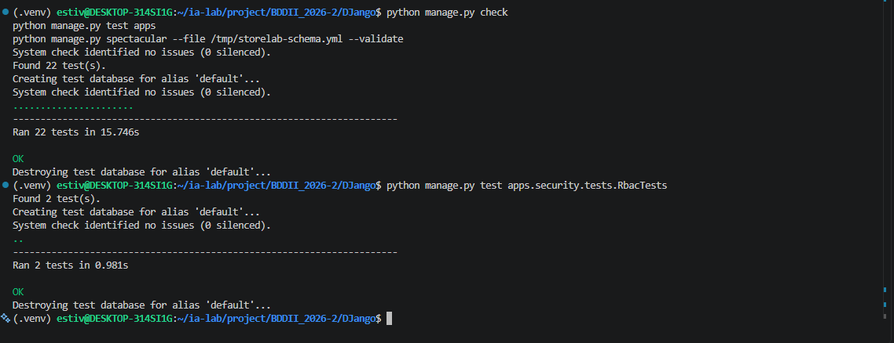
 demostrando la asignación correcta de HTTP 401 para peticiones anónimas, HTTP 403 para peticiones autenticadas sin concesión o con eslabones inactivos, y HTTP 200 únicamente cuando la cadena relacional RBAC está totalmente activa.
